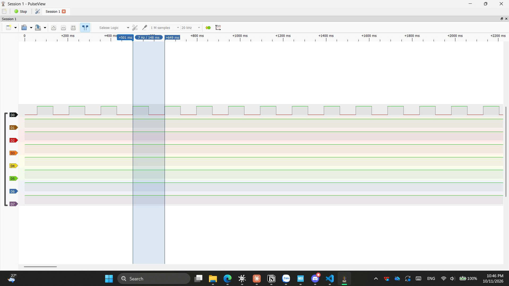

# Report — Week 1 / Ex1

`student_id`: 2413505    Commit của PREDICTION.md: 1g00, ngày 12/10/2026

## 1. Số đo
| Đại lượng | Giá trị |
|---|---|
| `BLINK_PERIOD_MS` (từ params.h) |149ms|
| Chu kỳ đo được — min |148.074ms|
| Chu kỳ đo được — max |148.043ms|
| Chu kỳ đo được — trung bình |148.0585ms|
| Sai số trung bình vs `BLINK_PERIOD_MS` |0.9415ms|
| `uxTaskGetStackHighWaterMark()` của bringup_task |82 words|

Ảnh PulseView (>= 10 chu kỳ, đọc được giá trị): 

## 2. Ba handler của kernel
| Tên trong port ARM_CM3 | Tên trong vector table | Nhiệm vụ |
|---|---|---|
| `vPortSVCHandler` |SVC_Handler|Khởi động scheduler và khôi phục ngữ cảnh task đầu tiên|
| `xPortPendSVHandler` |PendSV_Handler|Thực hiện context switch giữa các task|
| `xPortSysTickHandler` |SysTick_Handler|Tạo nhịp tick cho FreeRTOS, update tick count và xử lý thời gian delay của task|

Log lỗi link trước khi sửa (dán nguyên văn):

```
CMakeFiles/template.dir/D_/DOCUMENT/STUDY_-_OTHERS/RTOS_INTERN/intern-261-rtos-course-easy/third_party/FreeRTOS-Kernel/portable/GCC/ARM_CM3/port.c.obj: in function SVC_Handler': D:/DOCUMENT/STUDY - OTHERS/RTOS_INTERN/intern-261-rtos-course-easy/third_party/FreeRTOS-Kernel/portable/GCC/ARM_CM3/port.c:230: **multiple definition of SVC_Handler'**; CMakeFiles/template.dir/Core/Src/stm32f1xx_it.c.obj:D:/DOCUMENT/STUDY - OTHERS/RTOS_INTERN/intern-261-rtos-course-easy/week1/ex1/template/Core/Src/stm32f1xx_it.c:146: first defined here C:/PROGRA~2/ARMGNU~1/14EFD8~1.2RE/bin/../lib/gcc/arm-none-eabi/14.2.1/../../../../arm-none-eabi/bin/ld.exe: CMakeFiles/template.dir/D_/DOCUMENT/STUDY_-_OTHERS/RTOS_INTERN/intern-261-rtos-course-easy/third_party/FreeRTOS-Kernel/portable/GCC/ARM_CM3/port.c.obj: in function PendSV_Handler': D:/DOCUMENT/STUDY - OTHERS/RTOS_INTERN/intern-261-rtos-course-easy/third_party/FreeRTOS-Kernel/portable/GCC/ARM_CM3/port.c:459: **multiple definition of PendSV_Handler**'; CMakeFiles/template.dir/Core/Src/stm32f1xx_it.c.obj:D:/DOCUMENT/STUDY - OTHERS/RTOS_INTERN/intern-261-rtos-course-easy/week1/ex1/template/Core/Src/stm32f1xx_it.c:172: first defined here C:/PROGRA~2/ARMGNU~1/14EFD8~1.2RE/bin/../lib/gcc/arm-none-eabi/14.2.1/../../../../arm-none-eabi/bin/ld.exe: CMakeFiles/template.dir/D_/DOCUMENT/STUDY_-_OTHERS/RTOS_INTERN/intern-261-rtos-course-easy/third_party/FreeRTOS-Kernel/portable/GCC/ARM_CM3/port.c.obj: in function SysTick_Handler': D:/DOCUMENT/STUDY - OTHERS/RTOS_INTERN/intern-261-rtos-course-easy/third_party/FreeRTOS-Kernel/portable/GCC/ARM_CM3/port.c:492: **multiple definition of SysTick_Handler**'; CMakeFiles/template.dir/Core/Src/stm32f1xx_it.c.obj:D:/DOCUMENT/STUDY - OTHERS/RTOS_INTERN/intern-261-rtos-course-easy/week1/ex1/template/Core/Src/stm32f1xx_it.c:185: first defined here
```

Cách sửa: 
- **Xác định lỗi**: Lỗi này xảy ra vì SVC_Handler, PendSV_Handler và SysTick_Handler đang được định nghĩa 2 lần (trong file stm32f1xx_it.c do CubeMX sinh ra & trong FreeRTOS).
- **Cách fix**:
    + Bước 1: Ánh xạ lại 3 handler này cho FreeRTOS bằng cách config trong file FreeRTOSConfig.h
    + Bước 2: Xử lý handler trùng trong stm32f1xx_it.c bằng cách comment hoặc xóa nó đi.
    + Bước 3: Build lại.

## 3. Tại sao HAL timebase phải sang TIM4
Phải trả lời được: `HAL_IncTick()` chạy ở đâu, `configKERNEL_INTERRUPT_PRIORITY`
ảnh hưởng gì đến nó, và `HAL_Delay()` / `vTaskDelay()` khác nhau chỗ nào.

**Trả lời:**

- Để trả lời câu hỏi trên, ta xuất phát từ hàm HAL_IncTick(). Đây là hàm tăng biến đếm tick nội bộ uwTick của HAL, làm cơ sở thời gian cho các hàm như HAL_GetTick(), HAL_Delay(),... Mỗi lần gọi HAL_IncTick() sẽ làm biến uwTick tăng lên 1, thường tương ứng với khoảng thời gian 1 ms khi HAL timebase được cấu hình ở tần số 1 kHz.
- Mặc định, HAL sử dụng ngắt SysTick để gọi HAL_IncTick(). Trong khi đó, FreeRTOS cũng sử dụng SysTick để tạo RTOS tick, phục vụ việc quản lý thời gian chờ và lập lịch các task. Vì vậy, nếu cả HAL và FreeRTOS cùng sử dụng SysTick mà không cấu hình xử lý phù hợp, có thể xảy ra xung đột trong việc xử lý ngắt hoặc cập nhật tick.
- Để giải quyết vấn đề này, ta chuyển HAL timebase sang TIM4. Khi đó, TIM4 đảm nhiệm việc tạo ngắt định kỳ để cập nhật tick của HAL thông qua HAL_IncTick(), còn SysTick được dành cho FreeRTOS. Nhờ vậy, hai hệ thống có nguồn tick riêng, giúp tránh xung đột và đảm bảo hoạt động đúng của HAL cũng như bộ lập lịch FreeRTOS.
- Đối với configKERNEL_INTERRUPT_PRIORITY, đây là macro cấu hình mức ưu tiên ngắt kernel mà FreeRTOS sử dụng trên CM3. Macro này không trực tiếp điều khiển việc gọi HAL_IncTick() hay mức ưu tiên của TIM4. Tuy nhiên, nếu ISR gọi API FreeRTOS, mức ưu tiên của ISR phải tuân thủ các quy tắc ưu tiên ngắt của FreeRTOS, đặc biệt là giới hạn configMAX_SYSCALL_INTERRUPT_PRIORITY.
- Cuối cùng, cần phân biệt HAL_Delay() và vTaskDelay(). HAL_Delay() thường sử dụng cơ chế bận chờ dựa trên biến tick uwTick, khiến CPU tiếp tục thực thi vòng lặp chờ trong khi hàm chưa kết thúc. Ngược lại, vTaskDelay() đưa task hiện tại vào trạng thái Blocked trong khoảng thời gian yêu cầu, cho phép scheduler chuyển sang thực thi các task Ready khác. Vì vậy, trong các task của ứng dụng FreeRTOS, nên ưu tiên sử dụng vTaskDelay() khi cần trì hoãn, thay vì HAL_Delay().

## 4. Lệch so với dự đoán
Với mỗi mục trong `PREDICTION.md` lệch so đo: lệch bao nhiêu, và **nguyên nhân vật lý**
(không được trả lời "do sai số").

**Trả lời:** 
- Chu kỳ Predict: 148ms
- Chu kỳ thực tế (đo từ PulseView): 148.0585ms

     => Độ lệch: 58.5us
- Nguyên nhân: Ngoài những lý do bổ sung mà em có ghi trong file PREDICTION.md, một số lý do vật lý mà em nghĩ có thể ảnh hưởng đến sai số như sau:

    + Tần só dao động thực tế: Clock của MCU được tạo từ bộ dao động vật lý. Những sai lệch tần số so với giá trị danh định có thể làm ảnh hưởng đến bộ định thời, từ đó ảnh hưởng đến chu kỳ tick và thời gian đo được.
    + Vấn đề ở bộ Logic Analyzer: Bản chất bên trong bộ LA vẫn có xung nhịp để lấy mẫu số 1 bit (vì logic số nên chỉ ghi lại mức 0/1 nên chỉ cần 1 bit). Đôi khi xung nhịp sẽ không chính xác tuyết đối nên sẽ phát sinh ra sai lệch, từ đó đưa lên phần mềm và hiển thị sai.

## 5. Câu hỏi đánh đổi
`configTICK_RATE_HZ` = 1000 trong bài này. Dựa vào số đo của **bạn**, nếu hạ xuống
100 Hz thì chu kỳ LED và sai số thay đổi thế nào? Trả lời bằng con số, không bằng lý thuyết.

**Trả lời:**

- 1000 Hz: 1 tick = 1 ms, chu kỳ danh định 148 tick = 148 ms, đo được 148.0585 ms (lệch +0.0585 ms).
- 100 Hz: 1 tick = 10 ms, pdMS_TO_TICKS(148) bị cắt từ 14.8 xuống 14 tick, chu kỳ ≈ 14 × 10 ms = 140 ms (dự kiến đo ≈ 140.0585 ms).
- Sai số: Chu kỳ giảm 8 ms so với 148 ms mong muốn.
- Đánh đổi: tick 100 Hz giảm số lần ngắt SysTick 10 lần (ít tốn CPU hơn), nhưng độ phân giải delay thô là 10 ms, và BLINK_PERIOD_MS chỉ đạt được các giá trị 140, 150,… chứ không phải 148.
