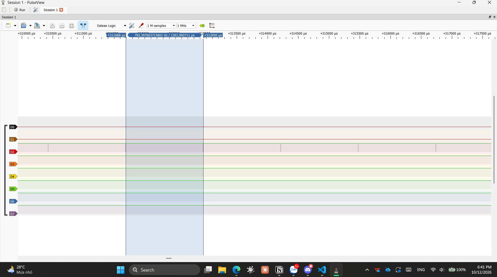

# Report — Week 1 / Ex2

`student_id`: 2413505    
Commit của PREDICTION.md: `feat: submit PREDICTION.md file for ex2` (10g, 12/10/2026)

## 1. CPU share đo được
| Cấu hình | A (%) | B (%) | C (%) | Time slice đo được | Ảnh |
|---|---|---|---|---|---|
| B2: preempt=1, ưu tiên khác nhau |0|0|100| — |[ex2_1.png](ex2_1.png)|
| B3: preempt=0, ưu tiên khác nhau |0|0|100| — |[ex2_2.jpg](ex2_2.jpg)|
| B4: preempt=1, cùng ưu tiên |~33.33|~33.33|~33.33| 1ms |[ex2_3.jpg](ex2_3.jpg)|
| B5: sau khi sửa starvation |~18|~30|~42|—|[ex2_4.jpg](ex2_4.jpg)|

Cách tính CPU share từ ảnh PulseView (mô tả ngắn): CPU share (%) = (Tổng thời gian task chiếm CPU trong một đoạn thời gian đo / Tổng thời gian của đoạn đo đó) x 100%.

## 2. Preemption nhìn thấy ở đâu
Trên ảnh **bước 4** (cùng ưu tiên, round-robin), chỉ ra ít nhất **2 thời điểm**
preemption xảy ra. Với mỗi thời điểm: dấu thời gian, task bị cắt, task chiếm CPU,
và vì sao (hết time slice, không phải block).

| t (us) | Task bị preempt | Task chiếm CPU | Lý do |
|---|---|---|---|
|998.99|C|A|Hết time slice, scheduler luân phiên sang task cùng mức ưu tiên tiếp theo đang Ready|
|1999.96|A|B|Hết time slice, scheduler luân phiên sang task cùng mức ưu tiên tiếp theo đang Ready|
|2998.89|B|C|Hết time slice, scheduler luân phiên sang task cùng mức ưu tiên tiếp theo đang Ready. Lúc này quay lại Task C|

Ở **bước 2** (ưu tiên khác nhau, đều busy-loop không block): giải thích vì sao ảnh
của bạn cho thấy **0 thời điểm preemption**, dù chạy bao lâu đi nữa — dựa vào điều
kiện preemption của FreeRTOS, không phải "vì ảnh chụp chưa đủ dài".
- Giải thích: FreeRTOS preempt task đang chạy khi có task ưu tiên cao hơn chuyển sang trạng thái Ready. Ở bước 2, task C có mức ưu tiên cao nhất và chạy busy-loop liên tục, không block hay nhượng quyền CPU. Vì C luôn chiếm CPU và không có task nào có mức ưu tiên cao hơn C chuyển sang Ready, điều kiện preemption không xảy ra. Do đó, A và B bị starvation, C tiếp tục chạy và có 0 thời điểm preemption giữa các task A, B, C, bất kể thời gian đo dài bao lâu.

## 3. Time slice
Time slice đo được ở bước 4: 1 ms. `configTICK_RATE_HZ` = 1000.
Sai số: 0.4 %. Giải thích sai số: Có thể xuất phát từ độ phân giải lấy mẫu của Logic Analyzer.

## 4. DWT wrap-around
Tại sao so sánh `DWT->CYCCNT > target` bị sai sau ~59 giây, và cách viết đúng:
- DWT->CYCCNT là bộ đếm 32-bit không dấu, tự quay về 0 khi tràn. Với CPU 72 MHz, thời điểm tràn (tính từ lúc bắt đầu đếm) là sau khoảng 59,65 s (2^32 / 72×10^6).

- Cách viết sai là so sánh giá trị tuyệt đối: tính target = CYCCNT + duration rồi chờ CYCCNT > target. Gần điểm tràn, target có thể quay về số nhỏ nên vòng lặp thoát ngay, hoặc CYCCNT đã tràn mà target vẫn là số lớn nên phải chờ gần 59 s.

- Cách viết đúng là so sánh hiệu: đọc start = DWT->CYCCNT một lần ngay trước khi chờ, rồi lặp trong khi (uint32_t)(DWT->CYCCNT - start) < duration_cycles. Phép trừ unsigned 32-bit là phép modulo 2^32 nên luôn cho đúng số chu kỳ đã trôi qua, kể cả khi CYCCNT đã tràn giữa chừng.
```
    ...
    const uint32_t start = DWT->CYCCNT;
    const uint32_t cycles = (72000000U / 1000000U) * microseconds;

    while ((uint32_t)(DWT->CYCCNT - start) < cycles) {/*Busy wait*/}
    ...
```

## 5. Sửa starvation
- **Cách tôi chọn:** thêm vTaskDelay() vào vòng lặp của task.
- **Vì sao nó hoạt động:** vTaskDelay(pdMS_TO_TICKS(x)) đưa task đang Running sang trạng thái Blocked trong x ms (với tick 1 kHz thì 1 ms bằng 1 tick). Khi task này bị Blocked, nó không còn nằm trong danh sách Ready, nên scheduler chọn task có ưu tiên cao nhất trong số các task đang Ready để chạy. Nhờ vậy Task B và Task A có CPU trong khoảng thời gian Task C bị Blocked. Khi Task C hết delay, nó trở lại Ready và, vì có ưu tiên cao hơn, sẽ preempt task đang chạy ở tick đó.
- **Đánh đổi:** Task C không còn chiếm CPU liên tục nên mức sử dụng CPU của C giảm; thời gian CPU được phân bổ cho A và B tăng lên. Tuy nhiên, vTaskDelay() làm tăng độ trễ phản hồi của C và độ trễ lập lịch phụ thuộc vào chu kỳ tick. Với tick 1 kHz, thời gian delay có độ phân giải danh định 1 ms, nhưng thời gian Blocked thực tế có thể ngắn hơn 1 ms tùy thời điểm gọi hàm so với tick. Ngoài ra, nếu chỉ thêm vTaskDelay() vào C thì B vẫn có thể chiếm CPU liên tục và khiến A bị starvation; muốn cả ba task đều có cơ hội chạy, cần bảo đảm B cũng định kỳ block hoặc nhường CPU.

## 6. Lệch so với dự đoán
Mỗi mục lệch + nguyên nhân vật lý.
- **Bước 2 & 3:** Không lệch, vì Task C chạy toàn thời gian nên CPU share đo được cũng là 100%.
- **Bước 4:** Time slice đo được lệch tối đa 1,01 µs so với giá trị danh định 1000 µs. Nguyên nhân có thể gồm độ phân giải lấy mẫu của Logic Analyzer, sai số xác định cạnh chuyển mức GPIO và độ trễ xử lý SysTick/scheduler.

## 7. Câu hỏi đánh đổi
Với **bộ ưu tiên của bạn**, nếu `TASK_C_WORK_US` tăng gấp 3 lần thì bảng CPU share ở
bước 2 thay đổi thế nào? Trả lời bằng số suy ra từ dữ liệu của bạn, rồi **đo lại để
kiểm chứng**. Nếu lệch, giải thích.

- **Dự đoán:** Khi TASK_C_WORK_US tăng gấp 3, CPU share dự kiến không thay đổi: A = 0%, B = 0%, C = 100%.

- **Giải thích:** TASK_C_WORK_US chỉ làm tăng thời gian GPIO của C ở mức HIGH trong mỗi lần xử lý, không làm thay đổi mức ưu tiên. Vì C có ưu tiên cao nhất và không block/yield, C tiếp tục chiếm CPU, A và B vẫn bị starvation.
- **Kiểm chứng:** 



=> Đúng với dự đoán. Theo dự đoán, thời gian GPIO mức high sẽ tăng lên gấp 3 (420*3 = 1260us), Task C chiếm toàn bộ thời gian CPU, task A/B không được thực thi. Kết quả thực nghiệm cho thấy thời gian đo được ~1261.397us, sai số nhỏ ~1.397us nên chấp nhận được. 
