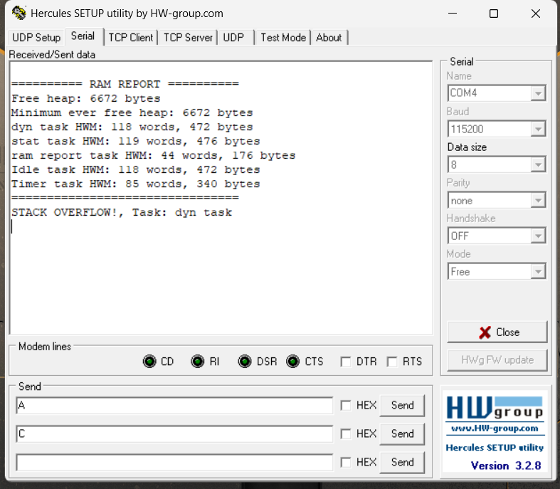
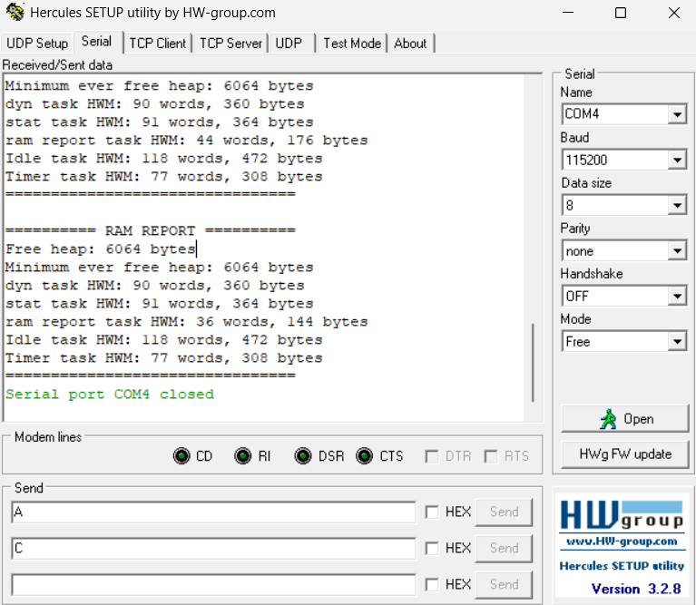

# Report — Week 1 / Ex4

`student_id`: 2413505    Commit của PREDICTION.md: `"feat: submit PREDICTION.md for ex4"`

## 1. Ngân sách RAM từ `.map`
| Mục | Symbol / section trong `.map` | Bytes |
|---|---|---|
| `.data` |.data|96|
| `.bss` (không kể heap) |.bss|2720|
| Heap FreeRTOS (`ucHeap`) |.bss.ucHeap|8192|
| Stack của main (MSP) |_Min_Stack_Size |1024|
| Còn lại / chưa dùng | — |8448|
| **Tổng** |Memory Configuration (xem chỗ RAM)| **20480** |

`.map` commit tại: `"feat: submit memory map file for ex4"`

## 2. Số lúc chạy (dán nguyên văn log UART)
```
========== RAM REPORT ==========
Free heap: 6672 bytes
Minimum ever free heap: 6672 bytes
dyn task HWM: 90 words, 360 bytes
stat task HWM: 100 words, 400 bytes
ram report task HWM: 38 words, 152 bytes
Idle task HWM: 108 words, 432 bytes
Timer task HWM: 85 words, 340 bytes
================================
```

| Đại lượng | Words | Bytes |
|---|---|---|
| `xPortGetFreeHeapSize()` | — |6672|
| `xPortGetMinimumEverFreeHeapSize()` | — |6672|
| HWM `dyn_task` |90|360|
| HWM `stat_task` |100|400|
| HWM `ram_report_task` |38|152|
| HWM idle task |108|432|
| HWM timer task |85|340|

Heap còn trống >= `TARGET_FREE_HEAP_BYTES` (4096)? Dựa trên kết quả được log từ UART, free Heap là 6672 bytes, lớn hơn `TARGET_FREE_HEAP_BYTES`.

## 3. Đối chiếu `.map` vs runtime
Heap trong `.map` = 8192 bytes ; `xPortGetFreeHeapSize()` = 6672 bytes ; lệch = 1520 bytes.

Lệch này gồm những gì (liệt kê từng mục kèm số bytes):
   + **512 bytes** (tương đương 128 words) cấp cho stack của Task "dyn task".
   + **800 bytes** (tương đương 200 words) cấp cho stack của Task "dyn task".
   + **152 bytes** (tổng của 2 TCB, mỗi TCB có kích thước 76 bytes) cấp cho TCB của 2 Task trên.
   + Metadata, Căn chỉnh, cấp phát khác: **56 bytes.**

## 4. Dynamic vs static
HWM của `dyn_task` và `stat_task` lệch 10 words dù làm cùng một việc. Vì sao?
`xTaskCreate` và `xTaskCreateStatic` khác nhau ở đâu về **nơi** TCB và stack nằm?

**Trả lời:** 
- **Giải thích về sự chênh lệch:** 
- **So sánh `xTaskCreate` và `xTaskCreateStatic`:**

|  | `xTaskCreate` | `xTaskCreateStatic` |
|---|---|---|
|TCB|Cấp phát từ cơ chế cấp phát động của FreeRTOS heap|Nằm trong biến StaticTask_t do tự khai báo, thường ở .bss|
|Stack|Cấp phát từ cơ chế cấp phát động của FreeRTOS heap|Nằm trong mảng StackType_t[] do tự khai báo, thường ở .bss|
|Ưu điểm|Gọn code, không phải tự quản lý cấp phát như static|Không phụ thuộc heap, không lo phân mảnh/hết heap|


## 5. Tràn stack
Log/ảnh chứng minh hook đã chạy:



Tại sao trong `vApplicationStackOverflowHook` không được gọi hàm UART blocking
(hoặc: nếu bạn vẫn gọi được, giải thích tại sao nó không crash — và tại sao đó là may):

- Không nên gọi hàm UART blocking trong `vApplicationStackOverflowHook` vì khi nhảy vào hook này, chính là đang có task bị tràn, hệ thống nên ưu tiên xử lý vấn đề tràn đó trước để tránh gây hậu quả xấu hơn. Nếu gọi UART blocking thì phải chờ cờ phần cứng/timeout, làm hệ thống bị treo tại hook và cản trở việc xử lý lỗi.
- Trong `vApplicationStackOverflowHook` của `hooks.c`, e đã lỡ gọi UART blocking, nhưng may mắn là hệ thống vẫn log UART được, có thể là do task bị tràn chưa ghi đè vào vùng nhớ quan trọng khác.
- Cách sử lý phù hợp: Có thể dùng GPIO để báo lỗi, hoặc đặt 1 biến `volatile` rồi debug để xem giá trị.

## 6. Stack nhỏ nhất an toàn
| Lần thử | Stack (words) | HWM (words) | Kết quả |
|---|---|---|---|
|1|128|118|overflow|
|2|129|120|overflow|
|3|130|120|overflow|
|4|131|5|no overflow|

Giá trị cuối cùng chọn: 131 words. Biên an toàn: 131 words. Lý do chọn biên đó: Đây là giá trị stack tổi thiểu để cấp cho task này (khi trong task này đang có mảng `HOG_DEPTH_BYTES` = 384 bytes) mà không gây ra overflow. Chọn giá trị tối thiểu để tiết kiệm bộ nhớ.

## 7. Lệch so với dự đoán
Mỗi dòng lệch + nguyên nhân.

|Mục|Dự đoán|Thực tế|Lệch|Nguyên nhân|
|---|---:|---:|---:|---|
| `.data` | 100 | 96 | -4 |Giá trị 100 bytes là giá trị mà em ước tính chưa có cơ sở vững chắc. Vì theo định nghĩa, các biến toàn cục/static được khởi tạo giá trị khác 0 sẽ lưu vào vùng này. Trong source code này, sử dụng rất nhiều các thư viện/driver, trong các file đó rất có thể sẽ chứa các khai báo biến toàn cục/static khác 0. Nên khi Linker gộp lại thành 1 file duy nhất, những biến đó chính là thứ chiếm vùng `.data`. Vì vậy, để dự đoán chính xác kích thước .data hơn, nên kiểm tra file .map|
| `.bss` (không kể heap) | 2000 | 2720 | **+720** |Ngoài nhưng biến mà em có thể dự đoán được do tự khai báo qua các file app_main/hooks/ram_report. Vẫn còn các biến toàn cục/static khác được khai báo bằng 0/NULL ở các thư viện/driver được liên kết, nên lý do cũng tương tự như trên.|
| Heap FreeRTOS (`ucHeap`) | 8192 | 8192 | 0 | Khớp, bằng `configTOTAL_HEAP_SIZE`. |
| Stack main (MSP) | 1024 | 1024 | 0 | Khớp, bằng `_Min_Stack_Size`. |
| Còn lại / chưa dùng | 9164 | 8448 | **-716** |Những sai lệch do dự đoán ở `.bss` và `.data` đã khiến phần này em trừ bị lệch|
| **Tổng** | 20480 | 20480 | 0 |Khớp|


## 8. Câu hỏi đánh đổi
Với `HEAP_SIZE_BYTES` = 8192 của bạn: nếu phải thêm một task nữa có stack 128 words,
**lấy RAM từ đâu**? Dựa vào bảng ngân sách của bạn, đưa ra 2 phương án kèm chi phí
cụ thể (bytes), rồi chọn một và **thực hiện, đo lại để chứng minh**.

**Trả lời:** 
- Nếu thêm một task nữa, thì tùy vào phương pháp cấp phát động hay tĩnh thì sẽ xác định được RAM sẽ lấy ở đâu.
    + Cấp phát động, dùng `xTaskCreate()`: Lấy RAM trong vùng heap được cấp cho FreeRTOS. Chi phí bao gồm: 76 bytes cho TCB và 128 bytes cho stack của task.
    + Cấp phát tĩnh, dùng `xTaskCreateStatic()`: Thường lấy ở phân vùng `.bss`. Chi phí bao gồm: 76 bytes cho TCB và 128 bytes cho stack của task.
- Chọn một: Chọn cấp phát động. Hiện tại, free heap là 6672 byte. Nếu đúng chi phí dự đoán thì sau khi tạo task, log UART bây giờ sẽ cho lại kết quả Free heap là 6084 byte.
- Kiểm chứng: 
    
=> Lệch 20 byte so với dự đoán. Lý do là bộ cấp phát heap_4.c có thêm overhead để quản lý các block bộ nhớ, bao gồm metadata và phần căn chỉnh kích thước cấp phát...
