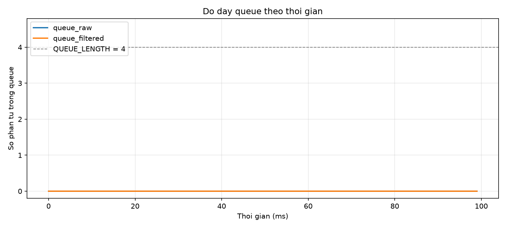
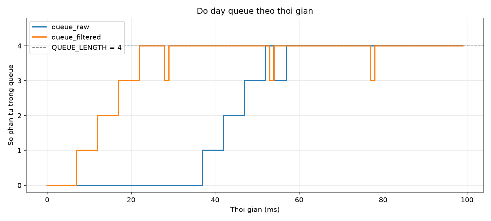

# Report — Week 2 / Ex1

`student_id`: 2413505    Commit của PREDICTION.md: `"feat: submit PREDICTION.md file for ex1 week2"`

## 1. Kích thước queue tối thiểu
| | Dự đoán | Đo được | Khớp? |
|---|---|---|---|
| `queue_raw` |1|1|Khớp|
| `queue_filtered` |1|1|Khớp|

Nếu lệch: nguyên nhân (thời gian xử lý thực tế khác ước lượng, jitter I2C, ...).

## 2. Đồ thị độ đầy queue theo thời gian
Cấu hình bình thường: 

- **Giải thích:** 
    + Như đã phân tích ở phần PREDICTION, sau khi lấy mẫu, sensor_task gọi vTaskDelay() và chuyển sang trạng thái Blocked trong 5 ms. Scheduler sẽ chọn các task đang ở trạng thái Ready để thực thi. Do filter_task và uart_task có cùng priority, khi xảy ra time slicing, CPU có thể chuyển sang uart_task nếu cả hai task đều đang Ready.

    + Khi được thực thi, filter_task lấy dữ liệu từ queue_raw bằng xQueueReceive() để xử lý. Nếu queue đang rỗng, task sẽ chuyển sang Blocked để chờ dữ liệu mới. Tương tự, uart_task cũng có thể chuyển sang Blocked khi chờ dữ liệu từ queue_filtered.

    + Trong khi đó, depth_logger_task kiểm tra độ đầy queue định kỳ theo mỗi tick, tương ứng khoảng 1 ms nếu tick rate của FreeRTOS là 1000 Hz. Vì thời gian xử lý dữ liệu qua pipeline ngắn hơn chu kỳ lấy mẫu và thời điểm logger kiểm tra không nhất thiết trùng với thời điểm dữ liệu đang tồn đọng, các queue thường đã được consumer (filter task và uart task) lấy hết phần tử khi logger đọc. Do đó, độ đầy queue được ghi nhận bằng 0, tạo thành đường đồ thị hằng số 0.

Cấu hình UART chậm (9600 baud): 

**Giải thích:** Khi giảm baud rate xuống 9600, tốc độ truyền dữ liệu qua UART giảm đáng kể, khiến uart_task tiêu thụ dữ liệu chậm hơn tốc độ mà filter_task đưa dữ liệu vào queue_filtered. Vì vậy, queue_filtered tăng dần độ đầy và đạt sức chứa tối đa 4 phần tử tại khoảng 22 ms. Khi queue này đầy, filter_task có thể bị Blocked tại thao tác gửi dữ liệu. Điều này làm giảm tốc độ tiêu thụ dữ liệu từ queue_raw, trong khi sensor_task vẫn tiếp tục tạo mẫu mỗi 5 ms. Do đó, queue_raw bắt đầu tích lũy dữ liệu từ khoảng 37 ms và đạt sức chứa tối đa tại khoảng 52 ms. Sau đó, cả hai queue chủ yếu duy trì ở trạng thái đầy.

## 3. Khi nào queue đầy
Mô tả **chính xác** thời điểm `queue_filtered` bắt đầu đầy khi hạ baud, và số mẫu bị mất/trễ (đếm bằng số thứ tự mẫu gắn trong payload).

**Trả lời:**
- Thời điểm `queue_filtered` bắt đầu đầy: 22ms
- Số mẫu bị trễ: 7 mẫu (đếm stt khi log ra Hercules)
- Số mẫu bị mất: Không có, vì khoảng trống seq chỉ xuất hiện nếu mẫu bị bỏ khi gửi (timeout 0 hoặc hữu hạn).

## 4. Hành vi 3 kiểu timeout
| Timeout | Kết quả quan sát khi queue đầy |
|---|---|
| 0 |`xQueueSend()` thất bại và trả về errQUEUE_FULL (tương đương pdFAIL) ngay lập tức, không làm task chuyển sang trạng thái Blocked để chờ queue trống|
| giá trị hữu hạn |Task chuyển sang trạng thái Blocked để chờ queue có chỗ trống trong thời gian tối đa đã chỉ định. Nếu queue có chỗ trống trong thời gian chờ, lệnh gửi có thể thành công. Nếu hết thời gian chờ mà queue vẫn đầy, xQueueSend() thất bại và trả về errQUEUE_FULL (tương đương pdFAIL), sau đó task tiếp tục thực thi khi được scheduler lập lịch|
| `portMAX_DELAY` |Task chuyển sang trạng thái Blocked và chờ cho đến khi queue có chỗ trống. Khi có chỗ trống, task có thể tiếp tục và gửi dữ liệu thành công. Nếu không có chỗ trống, task có thể chờ vô thời hạn. Với cấu hình hỗ trợ, portMAX_DELAY cho phép chờ vô thời hạn|

## 5. Lệch so với dự đoán
Phần dự đoán kích thước queue tối thiểu không có sai lệch. Dự đoán và thực tế đều cho thấy ở cấu hình bình thường (115200 baudrate), kích thước queue cần thiết tối thiểu là 1.

## 6. Câu hỏi đánh đổi
Với `SAMPLE_PERIOD_MS` của **bạn**, nếu `FILTER_WINDOW` tăng gấp đôi thì độ trễ từ cảm biến đến UART tăng thêm bao nhiêu ms? Trả lời bằng số từ dữ liệu của bạn, rồi đo lại để kiểm chứng.
