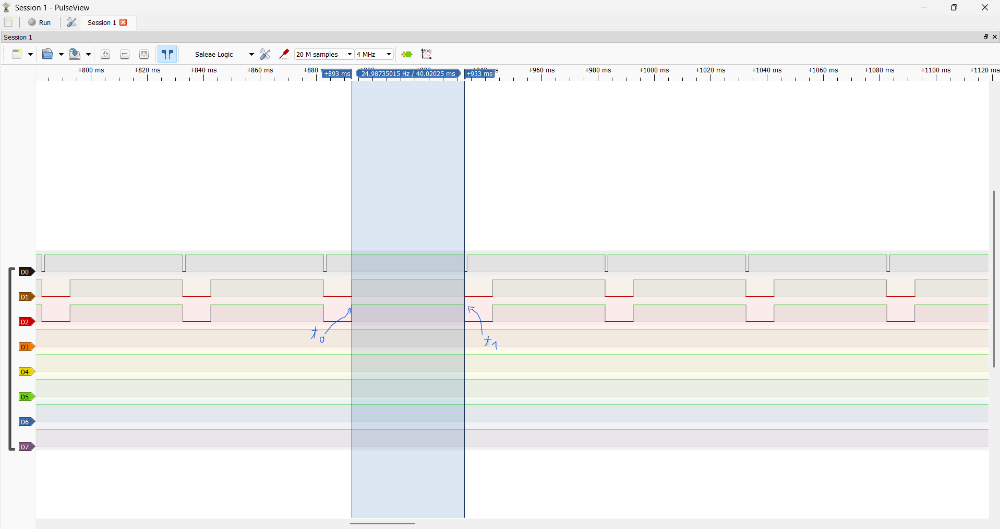
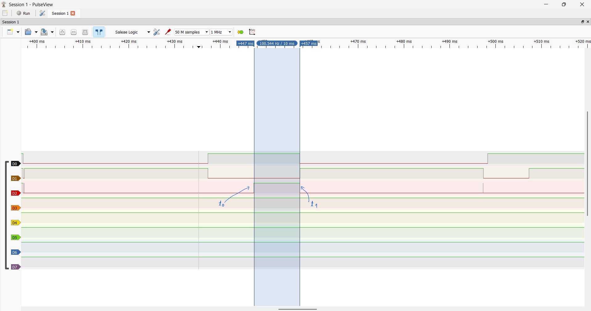
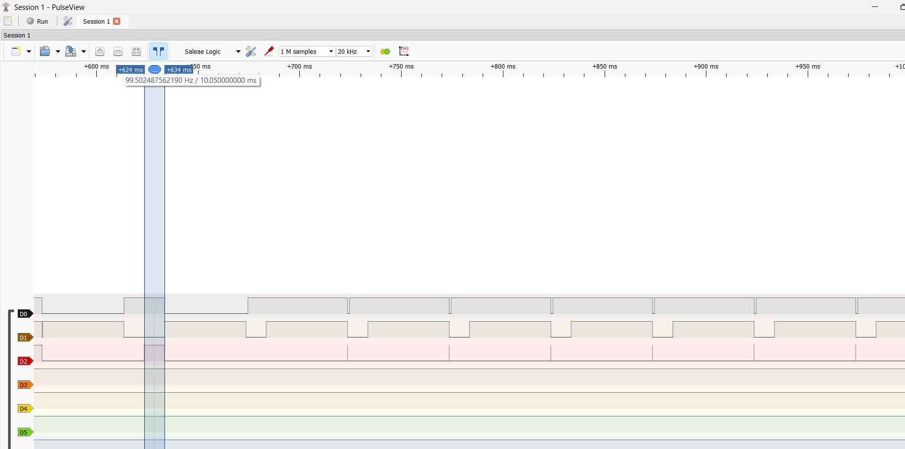
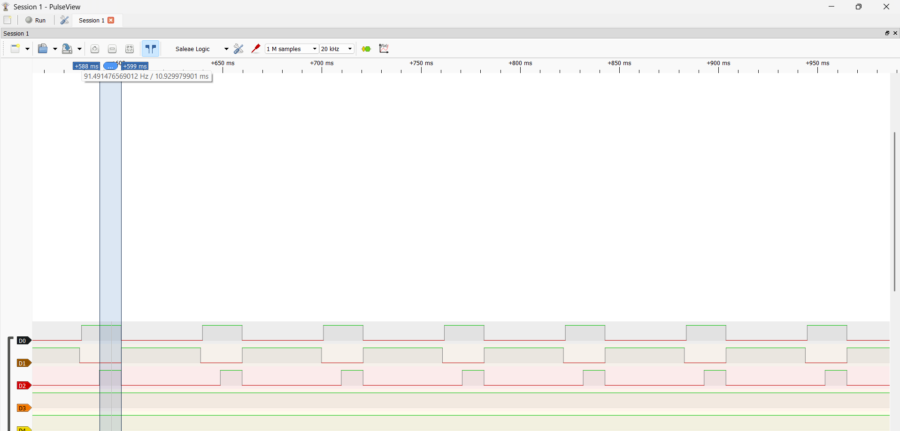
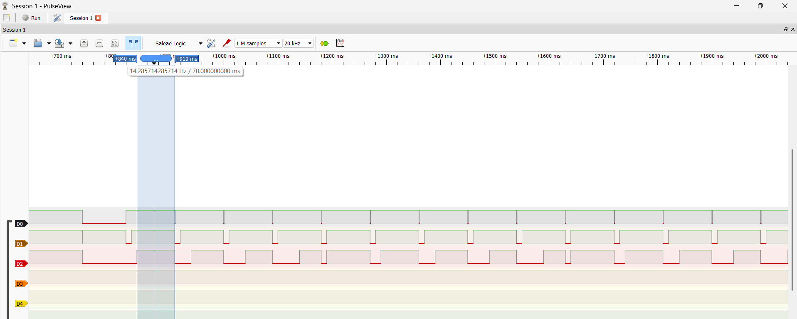
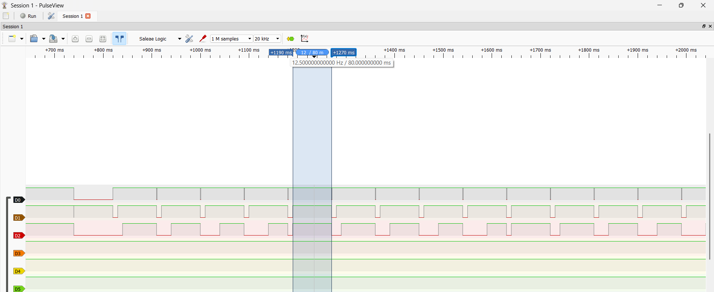

# Report — Week 2 / Ex3

`student_id`: 2413505    Commit của PREDICTION.md: `"feat: submit PREDICTION file for ex3 w2"`

## 1. Ảnh đo
Binary semaphore: 

Mutex: 

Trên mỗi ảnh, đánh dấu: thời điểm `task_high` sẵn sàng chạy (t0), thời điểm nó
thực sự chạy (t1). Thời gian block = t1 − t0.

## 2. Bảng thời gian block
| Cấu hình | t0 (us) | t1 (us) | Block (us) | Đạt `DEADLINE_MS`? |
|---|---|---|---|---|
| Binary semaphore |451900|491950|40050|No|
| Mutex |447270|457320|10050|Yes|

## 3. Vì sao mutex ngắn hơn
Giải thích bằng priority inheritance: `task_low` được nâng lên ưu tiên nào, khi
nào, và việc đó ngăn `task_mid` chen vào như thế nào.

**Trả lời:** 
- Task_low được nâng độ ưu tiên tạm thời lên bằng mức ưu tiên của task có độ ưu tiên cao nhất đang chờ lấy mutex, ở đây là task_high. Việc kế thừa độ ưu tiên xảy ra khi task_high bị block do không lấy được mutex đang được task_low nắm giữ. Khi đó, task_low được nâng độ ưu tiên lên bằng task_high để nhanh chóng hoàn thành công việc và giải phóng mutex.
- Việc nâng độ ưu tiên này giúp task_low có độ ưu tiên cao hơn task_mid, do đó scheduler sẽ ưu tiên cho task_low tiếp tục thực thi thay vì để task_mid chen vào chiếm CPU. Sau khi task_low giải phóng mutex, task_high có thể tiếp tục thực thi; task_low sẽ khôi phục độ ưu tiên ban đầu khi không còn cần kế thừa độ ưu tiên từ các task đang chờ mutex đó.

## 4. task_mid trong lúc inversion
Mô tả trạng thái kênh `task_mid` trên ảnh binary semaphore trong khoảng
inversion — chạy bao nhiêu lần, mỗi lần bao lâu.

**Trả lời:** Trên ảnh Logic Analyzer ở chế độ binary semaphore, trong khoảng priority inversion, kênh task_mid (D1) có 1 xung HIGH kéo dài khoảng 40 ms, tương ứng với thời gian task_mid thực thi công việc bận (MID_WORK_MS = 40 ms). Trong khoảng này, task_mid chiếm CPU, khiến task_low không thể tiếp tục chạy để giải phóng semaphore, làm task_high phải chờ lâu hơn.

## 5. Lệch so với dự đoán
Mỗi mục lệch + nguyên nhân vật lý.

**Trả lời:**
- **Thời gian task_high bị blocked bởi binary semaphore:** Lệch 10ms (dự đoán 50ms, đo thực tế ~40ms). Đây là hậu quả do em phân tích để predict bị sai. Sai ở chỗ là: task_low thực thi được khoảng 10ms thì bị preempt bởi task_mid. Task_mid thực thi xong 40ms thì tự blocked, rồi quay lại task_low. Với dự đoán ban đầu, em đã quên rằng dwt sẽ tiếp tục đếm dù task_low đã bị blocked, do nó độc lập nhau. Nên thực chất ngay sau khi task_low được lập lịch thực thi trở lại, thì lúc này thời gian đếm dwt đã trôi hết rồi, task_low kéo pin xuống rồi tự block, chứ không phải phải thực thi thêm 10ms nữa như em dự đoán. Sau đó task_high lúc đó sẽ được thực thi. => Tổng thời gian task_high bị blocked bởi binary semaphore phải là khoảng **~40ms.**
-  **Thời gian task_high bị blocked bởi mutex:** Lệch nhỏ, chỉ khoảng 50us. Tuy nhiên, theo em quan sát được rằng: Với cấu hình hiện tại, việc task_high bị ảnh hưởng 10ms bởi mutex chỉ xảy ra ở chu kỳ đầu (ngay sau lúc Reset). Phân tích như sau (dựa trên hình đo thực tế bên dưới):
    + Sau khi Reset, scheduler sẽ lập lịch cho high_task chạy trước, workload của high_task rất ít nên khi quan sát từ PulseView thì chỉ thấy 1 xung high trong thời gian cực ngắn.
    + Sau đó, task_high block 50ms. Task_mid được chạy, chạy 40ms thì tự block. Sau đó task_low sẽ được thực thi.
    + Task_low thực thi được 10ms thì task_high hết thời gian delay và chuyển sang Ready. Scheduler lập lịch cho task_high chạy nhưng task_high chỉ vừa chạy được set pin và đến xin lấy mutex thì bị Blocked, do task_low chưa nhả mutex. Sau đó, task_low được lập lịch trở lại và chạy nốt 10ms nữa thì nhả mutex. 
    + Task_high nhận được mutex thì tiếp tục thực thi. Nhưng cũng như đã phân tích, workload task_high rất ít nên khi quan sát sẽ thấy ngay sau khi task_low vừa kéo chân xuống thì task_high cũng đã xong luôn (biểu hiện là đã kéo chân xuống). Rồi sau đó task_high bị delay (block), **NHƯNG LƯU Ý Ở ĐÂY LÀ VTaskDelayUntil()**.
    + Task_high bị blocked thì scheduler sẽ lập lịch cho task_mid thực thi. Task_mid thực thi xong sau 40ms thì bị blocked. Lúc này, **task_high cũng đã xong thời gian delay 50ms của mình (vì vTaskDelayUntil đã lấy mốc từ lúc task_high chạy nhưng bị block 10ms bởi mutex)**, nên tính luôn 40ms này nữa thì đã đủ 50ms. Điều này vô tình khiến task_high được lập lịch ngay sau khi task_mid bị blocked. Task_high chạy xong trong tick tắc rồi mới nhường CPU cho task_low (vì lúc này task_mid đang bị block).
    + Cứ như vậy, task_high sẽ luôn được thực thi trước task_low ở những chu kỳ tiếp theo, và thời gian delay của task_high cũng kết thúc ngay lúc task_mid và task_low chạy xong.
    
    => Chỉ có chu kỳ đầu sau Reset thì thời gian bị trễ do mutex gây ra cho task_high mới là 10ms. Nhưng chu kỳ sau đó thì xấp xỉ 0.
    + Hình đo thực tế: 
    

    + Nếu sử dụng vTaskDelay() thay vì vTaskDelayUntil(), thì lúc này ta sẽ thấy được trễ do mutex gây ra cho task_high ở mỗi chu kỳ đều xấp xỉ 10ms.
    

## 6. Câu hỏi đánh đổi
Với bộ tham số của **bạn**, nếu `MID_WORK_MS` tăng gấp đôi thì thời gian block ở
cấu hình binary semaphore tăng thêm bao nhiêu? Trả lời bằng số từ dữ liệu của
bạn, rồi đo lại để kiểm chứng. `task_high` còn đạt `DEADLINE_MS` không?

**Trả lời:**
- Phân tích:
    + `MID_WORK_MS` lúc này là **80 ms.**
    + Ban đầu, task_high được lập lịch chạy. Task_high được hoàn thành trong tíck tắc rồi task_mid được thực thi.
    + Task_mid có thời gian thực thi khoảng 80ms. Nhưng chạy được 50ms thì task_high Ready và chen ngang. Nhưng task_high cũng xong trong tick tắc rồi lại nhượng quyền cho task_mid chạy nốt.
    + Task_mid chạy xong thì lúc này task_high còn bị block (còn bị block khoảng 30ms nữa). Vậy nên task_low được chạy. 
    + Task_low chạy được 10ms thì bị task_mid vừa được Ready lại preempt. Task_mid thực thi 10ms thì lại bị task_high preempt. Nhưng task_high chỉ thực thi được set pin và xin lấy semaphore thì đã bị Blocked do task_low đang giữ. Kết quả là task_mid sẽ chạy tiếp 70ms tiếp theo mà không bị task nào khác can thiệp. 
    + Hết thời gian task_mid thực thi. Task_high dành CPU, diễn ra trong tick tắt rồi kéo pin xuống, rồi blocked. Task_low được chạy lại, nhưng dwt cũng đã đếm xong từ lâu nên cũng kéo pin rồi blocked luôn. 
    
    => Task_high sẽ bị trễ do mutex gây ra là khoảng **70ms**. Tuy nhiên, đây chỉ là trễ ở những chu kỳ đầu, nếu tiếp tục phân tích xung thì khả năng độ trễ ở phía sau vẫn có thể tăng thêm.

- Đo thực tế:
    + Độ trễ ghi nhận ở chu kỳ đầu sau Reset (70ms):

    + Độ trễ lớn nhất ghi nhận được (80ms):

- `Task_high` không đạt `DEADLINE_MS` khi `MID_WORK_MS` tăng gấp đôi. 