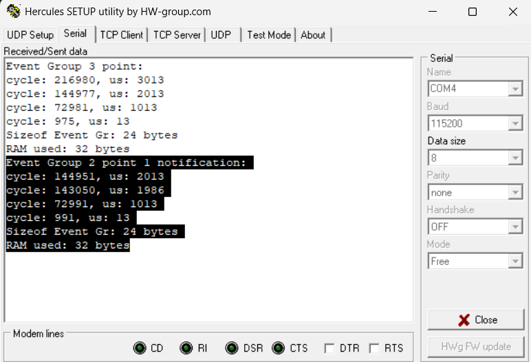
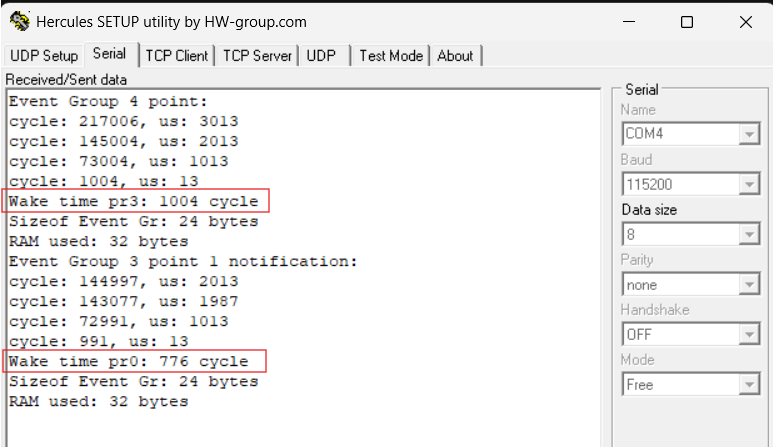
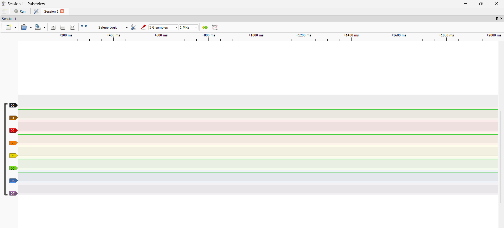
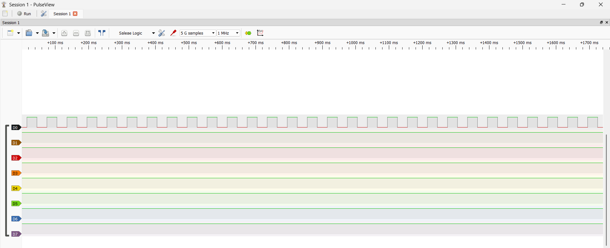
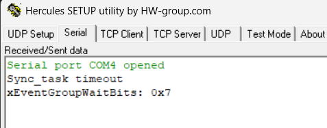
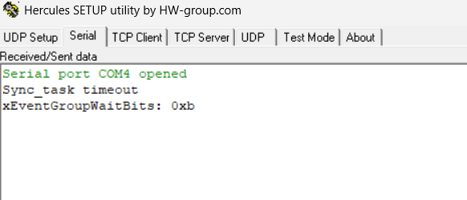
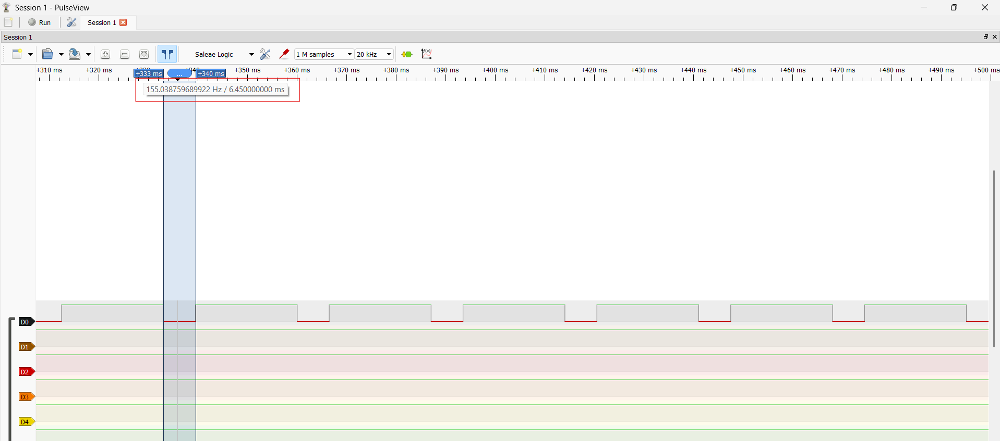
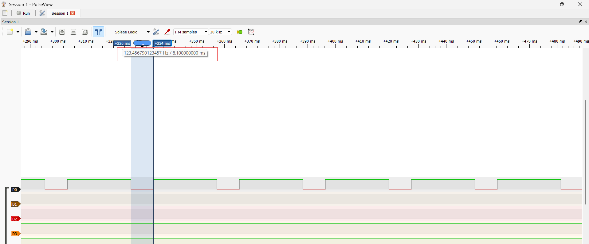

# Report — Week 2 / Ex4

`student_id`: 2413505    Commit của PREDICTION.md: `"feat: submit Prediction file for ex4 w2"`

**NOTE:** Vì param của bài em là 

## 1. Bảng so sánh RAM
| | Bytes thực tế | Cách tính |
|---|---|---|
| Event group (4 điểm đồng bộ) |24 bytes|sizeof(StaticEventGroup_t) và độ chênh xPortGetFreeHeapSize() quanh xEventGroupCreate(), in qua UART|
| Event group (3 điểm) + notification (1 điểm) |24 bytes|Cùng cách đo, build với PRODUCER0_USE_NOTIFY = 1|
| Chênh lệch |0|Các bit chung một EventGroup_t. Notification dùng trường có sẵn trong TCB|

Hình ảnh:

- Giải thích tại sao RAM used = 32 bytes: Với cơ chế quản lý heap4, mỗi lần cấp phát có thêm 1 `BlockLink_t` chứa thông tin quản lý block bộ nhớ, thường là 8 bytes. Vì vậy, tổng RAM của Event Group (24 bytes) và BlockLink_t (8 bytes) nên log ra UART là 32 bytes. **Nhưng đề hỏi là RAM cho Event Group nên đáp án là 24 bytes.**

## 2. Bảng so sánh tốc độ đánh thức
| Cách | Thời gian đánh thức (cycle) | Thời gian đánh thức (us) |
|---|---|---|
| Event-group-bit (producer_3) |1004|13.94|
| Task notification (producer_0) |776|10.78|

Mô tả cách đo (2 điểm DWT: lúc gọi set/notify, lúc sync_task bắt đầu chạy):
- Chệnh lệch giữa t1 và t0 (t1 - t0) chính là thời gian đánh thức kể từ khi producer gọi đến sync_task chạy.
- Các biến được sử dụng để đo:
    + Mảng producer_t0[EVENT_BIT_COUNT]: Dùng để ghi nhận thời điểm t0 (lúc producer gọi set/notify).
    + Biến producer_1: Dùng để ghi nhận thời điểm t1. Đây là thời điểm khi tất cả các producer đã set/notify, sync_task được chạy.
    + Biến spec_t1: Dùng riêng để ghi nhận thời điểm mà producer_0 gửi notify, syns_task nhận và được chạy (chạy đến ngay lệnh chờ Event group thì Blocked).
- **Đo thời gian đánh thức của producer_0:** Dùng phần tử `producer_t0[0]` để ghi nhận t0, `spec_t1` để ghi nhận t1. Hiệu giữa 2 biến chính là giá trị cần tìm.
- **Đo thời gian đánh thức của producer_3:** Dùng `producer_t0[3]` và `producer_t1`. Mặc dù `producer_t1` ghi nhận thời điểm đã thỏa hết các điều kiện set bit/notify, nhưng nếu xét riêng producer_3 thì đây cũng chính là lúc `sync_task` được đánh thức: producer_3 là producer set bit cuối cùng, nên lần `xEventGroupSetBits` của nó mới là lần làm đủ mask và unblock `sync_task`, còn các lần set trước đó chưa đủ điều kiện nên không đánh thức `sync_task`.

- Ảnh đo: 

## 3. Khi nào KHÔNG dùng được notification
Tình huống bạn dự đoán ở PREDICTION.md, kiểm chứng lại: đúng hay sai, vì sao.

**Trả lời:** 
- **Chuẩn bị:** Để kiểm chứng tình huống trên, em sẽ tạo thêm 1 task (`another_task`), cho task này chờ notify, nếu nhận notify thành công (notification value khác 0) thì sẽ toggle pin PA0. Xét 2 tình huống:
    + **Không task nào gửi notify đến:** Chứng tỏ rằng nếu không gửi trực tiếp notify đến task này thì nó sẽ không chạy.
    + **Có gửi notify đến:** Để chứng minh rằng nếu muốn task chạy thì phải biết handle của nó và gửi riêng notify cho nó, chứ không phải là gửi vào 1 oject chung như Event Group.
- **Kiểm chứng:**
    + **Trường hợp 1:** Không task nào gửi trực tiếp đến nên PA0 không được toggle.

    + **Trường hợp 2:** Các producer gửi notify trực tiếp đến another_task, task thỏa điều kiện nên có toggle PA0.

## 4. Timeout
Log/ảnh một lần `sync_task` bị timeout (cố tình làm 1 producer chậm hơn
`SYNC_TIMEOUT_MS`), và giá trị trả về của `xEventGroupWaitBits` lúc đó.

**Trả lời:** 
- **Chuẩn bị:** Tại đoạn xử lý `uxBits` trả về từ `xEventGroupWaitBits`em thêm 1 đoạn code: Nếu `uxBits` AND với bit mask != bit mask => sync_task bị timeout. Chương trình sẽ log thông báo timeout và giá trị hiện tại của `uxBits`ra UART.
- **Tình huống 1:** producer_3 chậm hơn `SYNC_TIMEOUT_MS`. Kết quả `uxBits = 0x0111`

- **Tình huống 1:** producer_2 chậm hơn `SYNC_TIMEOUT_MS`. Kết quả `uxBits = 0x1011 = 0xb`

## 5. Lệch so với dự đoán
Mỗi mục lệch + nguyên nhân vật lý.

**Trả lời:**
- **Dự đoán về lượng RAM dùng cho Event Group:** Không lệch, kết quả dự đoán và thực nghiệm đều cho ra **24 bytes.**
- **Dự đoán về tốc độ đánh thức của notification và Event Group:** Dự đoán đúng về mặt xu hướng rằng thời gian đánh thức của notification sẽ nhanh hơn so với Event Group.

## 6. Câu hỏi đánh đổi
Với `EVENT_BIT_COUNT` của **bạn**, nếu tăng thêm 1 bit (1 producer nữa) thì chu kỳ đồng bộ trung bình đo được thay đổi thế nào? Trả lời bằng số từ dữ liệu của bạn, rồi đo lại để kiểm chứng.

**Trả lời:** 
- Nếu tăng thêm 1 producer nữa thì **chu kỳ đồng bộ trung bình sẽ tăng lên** vì chu kỳ đồng bộ tăng. Vì sync_task phải chờ thêm 1 bit sự kiện nữa từ producer mới thêm vào.
- **Chuẩn bị đo:** Thực hiện phép đo bằng toggle pin PA0. Set pin = 1 ngay khi điều kiện chờ các bit/notify được thỏa và reset pin về 0 ngay khi hết workload của sync_task. Không có vTaskDelay() nên Scheduler sẽ lập lịch cho sync_task chạy tiếp (vì có priorty cao nhất), nhưng sync_task sẽ bị Blocked ngay sau đó vì chưa thỏa điều kiện bit/notify. Vì vậy, khoảng thời gian PA0 ở mức HIGH là workload của sync_task, còn khoản thời gian PA0 ở mức LOW chính là chu kỳ đồng bộ của sync_task.
- Kiểm chứng:
    + Trước khi thêm 1 bit: Chu kỳ ~6ms

    + Sau khi thêm 1 bit: Chu kỳ tăng thêm ~2ms

