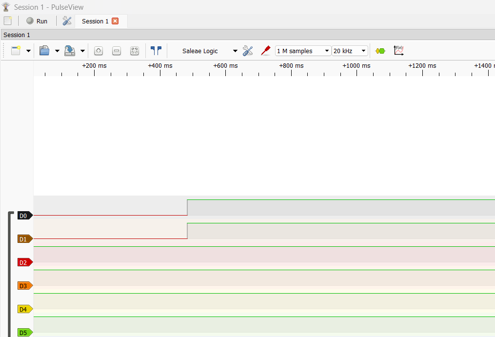
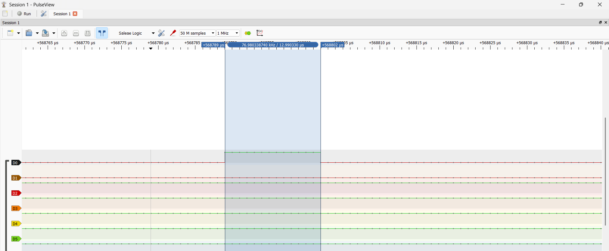
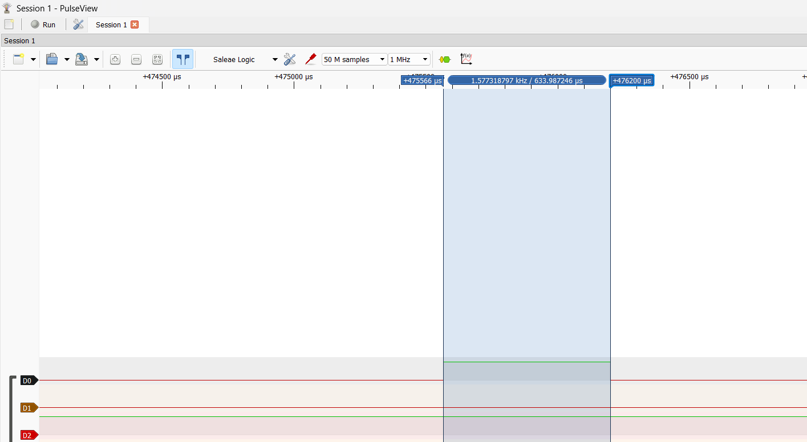
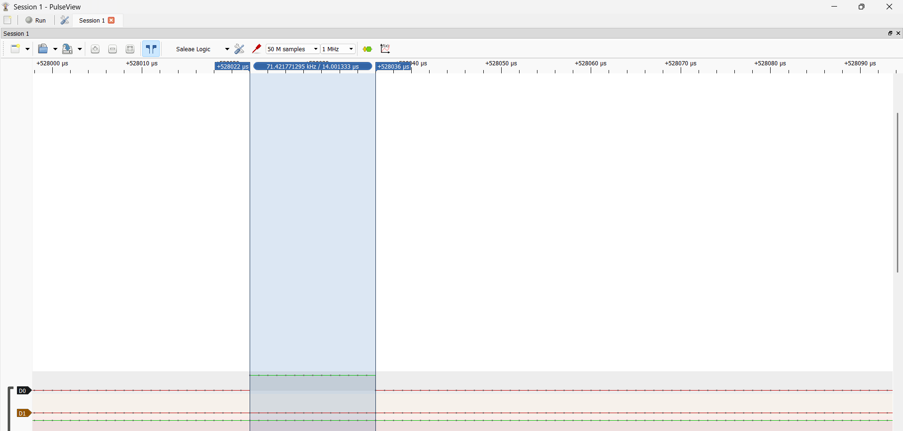
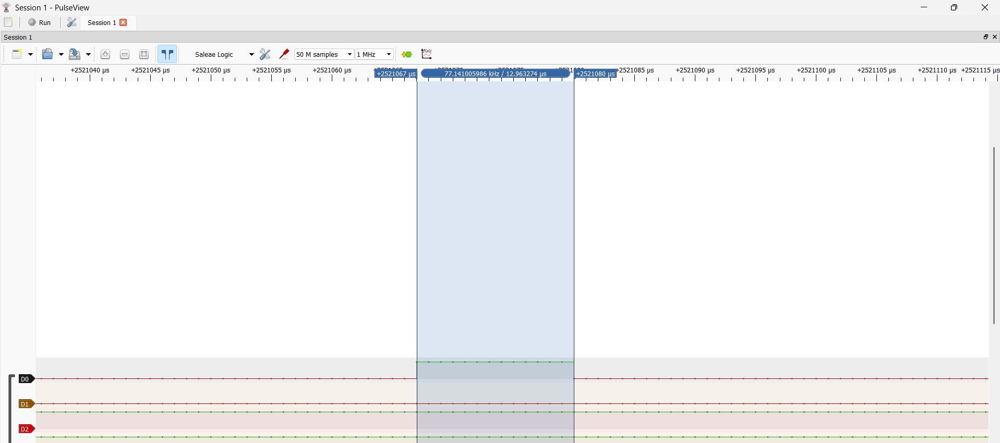

# Report — Week 3 / Ex1

`student_id`: 2413505    Commit của PREDICTION.md: `"feat: submit Prediction file for ex1 w3"`

## 1. Bằng chứng configASSERT
Mô tả/log/ảnh lúc priority sai (bước 4 README) + giải thích chính xác **vì sao**
assert được kích hoạt (nêu đúng tên macro và điều kiện).

**Trả lời:**
- **Hiện tượng:** Với code hiện tại, để kiểm chứng xem assert đã được kích hoạt hay chưa thì bên trong configASSERT() sau khi check điều kiện thì em có set GPIOC PIN_13. Vậy nên, nếu assert được kích hoạt thì sau lần bấm nút đầu tiên, PIN_13 sẽ mức HIGH, còn không thì mức LOW.
- **Kiểm chứng:** Hình ảnh cho thấy sau khi nhấn nút, hệ thống vào ISR (pin PA7 được set), nhưng khi call API của FreeRTOS thì không hợp lệ (vì priorty sai), nên assert được kích hoạt, pin PC13 bị kéo lên HIGH, đồng thời PA7 cũng bị giữ HIGH chứ không toggle (chi tiết hơn ở câu 2):

- *Giải thích:** Khi ISR có priority cao hơn mức cho phép nhưng vẫn gọi API FreeRTOS FromISR, kernel sẽ kiểm tra thông qua macro `portASSERT_IF_INTERRUPT_PRIORITY_INVALID()` và kích hoạt configASSERT nếu priority không hợp lệ. Trên Cortex-M, số NVIC priority càng nhỏ thì mức ưu tiên càng cao, nên nếu priority của ISR nhỏ hơn configLIBRARY_MAX_SYSCALL_INTERRUPT_PRIORITY thì ISR đó không được phép gọi API FreeRTOS. Khi vi phạm, `portASSERT_IF_INTERRUPT_PRIORITY_INVALID()` gọi configASSERT để dừng chương trình, bảo vệ kernel khỏi ISR có mức ưu tiên quá cao.

## 2. Latency ISR → task
| Cấu hình | Dự đoán (us) | Đo được (us) | Đạt `LATENCY_BUDGET_US`? |
|---|---|---|---|
| Có `portYIELD_FROM_ISR` |13.89|12.99|Yes|
| Không có `portYIELD_FROM_ISR` |513.89|633.99|No|

Ảnh logic analyzer đính kèm cho cả 2 cấu hình.
- Cấu hình 1 (có `portYIELD_FROM_ISR`):

- Cấu hình 2 (không có `portYIELD_FROM_ISR`):

## 3. Giải thích quan hệ priority
Giải thích bằng lời của bạn: số NVIC priority nhỏ/lớn nghĩa là gì, vì sao
`configLIBRARY_MAX_SYSCALL_INTERRUPT_PRIORITY` tồn tại, điều gì xảy ra nếu một
ISR ưu tiên cao hơn ngưỡng này gọi API FreeRTOS.

**Trả lời:** 
- Với NVIC priority của Cortex-M, số càng nhỏ thì mức ưu tiên càng cao, số càng lớn thì mức ưu tiên càng thấp. Ví dụ: priority 0 cao hơn 5.
- configLIBRARY_MAX_SYSCALL_INTERRUPT_PRIORITY xác định ngưỡng ưu tiên của các ISR được phép gọi API FreeRTOS. ISR muốn gọi các API FromISR phải có priority thấp hơn hoặc bằng ngưỡng này.
- Vì vậy, nếu một ISR có priority cao hơn ngưỡng (số priority nhỏ hơn configLIBRARY_MAX_SYSCALL_INTERRUPT_PRIORITY) mà vẫn gọi API FreeRTOS, việc này vi phạm quy tắc của FreeRTOS và có thể gây lỗi/assert, hoặc hành vi không xác định.

## 4. Lệch so với dự đoán
Mỗi mục lệch + nguyên nhân vật lý (jitter NVIC, pipeline, v.v.).
- **Lệch ở cấu hình 1:** Latency thực tế phụ thuộc vào chu kỳ máy và số chu kỳ lệnh trong đường đi từ ISR -> context switch. Chu kỳ máy có thể ước lượng gần như chính xác dựa trên tần số CPU đang cấu hình, trong khi số chu kỳ lệnh chỉ có thể ước tính tương đối chứ chưa biết chính xác từng lệnh. Muốn biết chính xác hơn cần phân tích mã máy hoặc đo trực tiếp bằng DWT/CYCCNT. Vì vậy, latency thực tế 12.99 µs thấp hơn giá trị ước tính 13.89 µs, chênh khoảng 0.90 µs là có thể xảy ra.

- **Lệch ở cấu hình 2:** Mặc dù đã dự đoán đúng xu hướng rằng nếu không dùng `portYIELD_FROM_ISR` thì Task sẽ phải chờ đến lần tick tiếp theo, nên latency có thể tăng tối đa gần 1 ms, trung bình khoảng 500 µs với `configTICK_RATE_HZ = 1000`. Tuy nhiên, 500 µs chỉ là giá trị trung bình lý thuyết, không phải latency cố định. Độ trễ thực tế còn phụ thuộc vào thời điểm ISR xảy ra so với tick kế tiếp và các xử lý khác của kernel. Do đó, giá trị đo được 633.99 µs cao hơn dự đoán 513.89 µs khoảng 120.10 µs. Sai lệch này cho thấy thành phần chờ tick thực tế không đúng chính xác 500 µs; ngoài thời gian chờ tick còn có overhead xử lý ISR, scheduler và context switch, cũng như jitter do thời điểm xảy ra ngắt.

## 5. Câu hỏi đánh đổi
Nếu tăng `ISR_NVIC_PRIO` của bạn lên một bậc (ưu tiên thấp hơn) trong khi vẫn hợp lệ, latency đo được thay đổi bao nhiêu? Trả lời bằng số đo thật, không đoán.

**Trả lời:** 
- Khi tăng `ISR_NVIC_PRIO` trong khoảng hợp lệ, em thấy rằng giá trị đo được không có xu hướng tăng/giảm cố định. Điều này cho thấy trong điều kiện thí nghiệm này, thay đổi priority của ISR trong vùng hợp lệ không tạo ra ảnh hưởng đáng kể và có tính xác định lên latency. Vì vậy, không thể kết luận rằng cứ tăng ISR_NVIC_PRIO một bậc thì latency sẽ tăng hoặc giảm tương ứng.
    + Đo lần 1: Có tăng latency

    + Đo lần 2: Xấp xỉ latency ở cấu hình ban đầu

