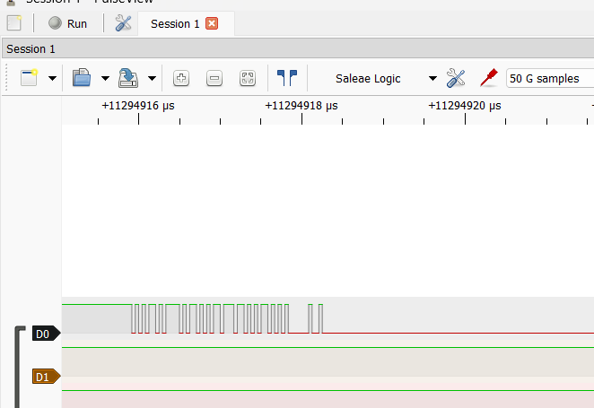
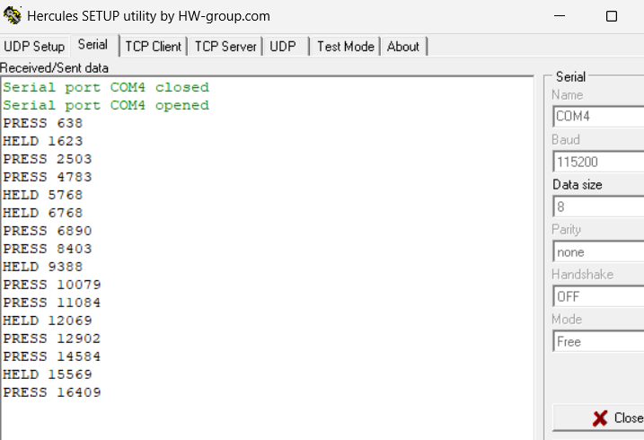
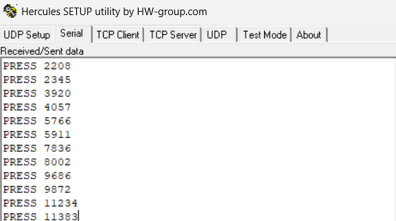

# Report — Week 3 / Ex2

`student_id`: 2413505    Commit của PREDICTION.md: `"feat: submit Prediction file for ex2 w3"`

## 1. Nảy phím trước/sau
Ảnh logic analyzer: tín hiệu thô (nhiều cạnh nảy) và tín hiệu "PRESS" sau khi qua `debounce_timer` (một cạnh sạch).

**Trả lời:** 

## 2. Callback bị block — thí nghiệm bước 4
| | Dự đoán | Đo được |
|---|---|---|
| Độ trễ `longpress_callback` khi `debounce_callback` block 50ms |50ms|0|

Log timestamp (`xTaskGetTickCount()`) của cả hai callback quanh lúc bị block.

- **Note:** debounce_timer và longpress_timer được kích hoạt gần như cùng thời điểm nhưng hoạt động độc lập. debounce_timer hết hạn sau 15 ms nên tạo sự kiện log PRESS, trong khi longpress_timer tiếp tục đếm đủ 1000 ms kể từ thời điểm được START. Vì vậy khoảng thời gian từ log PRESS đến log HELD xấp xỉ 1000 - 15 = 985 ms.

## 3. Giải thích daemon task
Giải thích **bằng cơ chế**, không chỉ hiện tượng: vì sao một callback block sẽ
ảnh hưởng timer khác, liên hệ đến timer command queue và việc có đúng MỘT
daemon task xử lý tất cả software timer.

**Trả lời:** 
- Trong FreeRTOS, tất cả Software Timer đều được quản lý bởi một Daemon Task duy nhất. Các thao tác như START, STOP, RESET từ task hoặc ISR không trực tiếp xử lý timer mà được gửi vào Timer Command Queue để Daemon Task xử lý tuần tự.
- Khi Daemon Task thực thi một timer callback, callback đó chạy trực tiếp trong context của Daemon Task. Vì vậy, nếu callback gọi vTaskDelay(50 ms), chính Daemon Task bị block trong 50 ms. Trong khoảng thời gian này, Daemon Task không thể lấy và xử lý các command tiếp theo trong Timer Command Queue, cũng không thể thực thi callback của các timer khác.
- Tuy nhiên, không phải cứ callback block 50 ms là timer khác chắc chắn bị trễ 50 ms. Timer khác chỉ bị ảnh hưởng nếu thời điểm nó hết hạn hoặc command của nó cần được xử lý rơi vào khoảng Daemon Task đang bị block. Nếu timer khác hết hạn sau khi Daemon Task đã chạy lại thì callback của nó không bị trễ/trễ không đáng kể.
- Với bài này, debounce_timer hết hạn sau 15 ms, trong khi longpress_timer có chu kỳ 1000 ms. Do đó trong trường hợp bình thường, debounce_callback() block 50 ms từ khoảng 15–65 ms, còn longpress_timer chỉ hết hạn khoảng 1000 ms sau khi được start. Hai khoảng thời gian không chồng lên nhau nên không quan sát thấy longpress bị trễ 50 ms.

## 4. Long-press
Thời gian giữ thực tế đo được so với `LONGPRESS_MS`: khớp không?

**Trả lời:** Có, kết quả đo phù hợp với LONGPRESS_MS = 1000 ms (đã phân tích ở câu 2).

## 5. Lệch so với dự đoán
Mỗi mục lệch + nguyên nhân.

**Trả lời:** 
- **Dự đoán:** longpress_callback có thể bị trễ khoảng 50 ms nếu longpress_timer hết hạn trong lúc debounce_callback đang block.
- **Thực tế:** Trong thí nghiệm hiện tại, không quan sát thấy độ trễ 50 ms.
- **Giải thích:** debounce_timer hết hạn sau khoảng 15 ms, nên debounce_callback() block từ khoảng 15–65 ms. Trong khi đó longpress_timer được START gần thời điểm nhấn và chỉ hết hạn sau 1000 ms. Hai khoảng thời gian không chồng lấn, nên khi longpress_timer hết hạn thì Daemon Task đã thoát khỏi vTaskDelay(50 ms) và có thể xử lý longpress_callback() bình thường.

## 6. Câu hỏi đánh đổi
Với `DEBOUNCE_MS` của bạn, nếu giảm xuống còn một nửa thì tín hiệu sau debounce
còn sạch không? Đo lại trên board của bạn, không suy luận suông.

**Trả lời:** 
- **Suy luận:** Còn sạch, vì tùy thuộc vào loại nút nhấn. Nút nhấn em dùng thực tế khi quan sát ở bài trước khá hiếm khi xảy ra bounce phím (hoặc bounce rất ít), nên nhìn chung 7ms vẫn đủ.
- **Phương pháp đo thực tế:** Chỉnh `DEBOUNCE_MS = 7 ms`, thực hiện nhiều lần nhấn nhả và ghi nhận số log PRESS thực tế. Nếu mỗi lần nhấn/nhả tương ứng với 1 log PRESS ra UART thì chứng tỏ debounce vẫn còn sạch. Ngược lại, nếu xuất hiện log PRESS dư thì debounce không còn sạch.
- **Kiểm chứng:** Kết quả sau 6 lần nhấn nhả nút thì cho đúng 12 log PRESS.

