# Report — Week 3 / Ex3

`student_id`: 2413505    Commit của PREDICTION.md: `"feat: submit Prediction file for ex3 w3"`

## 1. Thời gian byte & độ sâu stream buffer
Phép tính thời gian 1 byte ở `RX_BAUD`, và số lệnh tối đa chứa được trong
`STREAM_BUFFER_BYTES`.

**Trả lời:** 
- **Phép tính thời gian 1 byte ở `RX_BAUD = 57600 baud`:** 
```
Cấu hình khung truyền 8N1: 8 bit data, no parity, 1 stop bit => 10bit/lần gửi.
   => Tốc độ 1 lần gửi: t = 10 / 57600 = 173.61 (us)
```
- **Phép tính số lệnh tối đa chứa được trong `STREAM_BUFFER_BYTES`:**
```
- Kích thước của Stream buffer (STREAM_BUFFER_BYTES): 96 bytes
- Kích thước 1 lệnh có độ dài MAX_CMD_LEN: 16 bytes
   => Số lệnh tối đa = 96 / 16 = 6 (lệnh) 
```

## 2. Demo 3 loại lệnh
Bằng chứng (log/ảnh) `demo_task` phản ứng đúng với `P`, `S`, `T` — mỗi loại ít nhất 1 ví dụ có số liệu trước/sau.

**Trả lời:**
- **Phản ứng với `P`:** 
    + Trước khi gửi `P50\r`, PC13 toggle với chu kỳ mặc định 200ms.
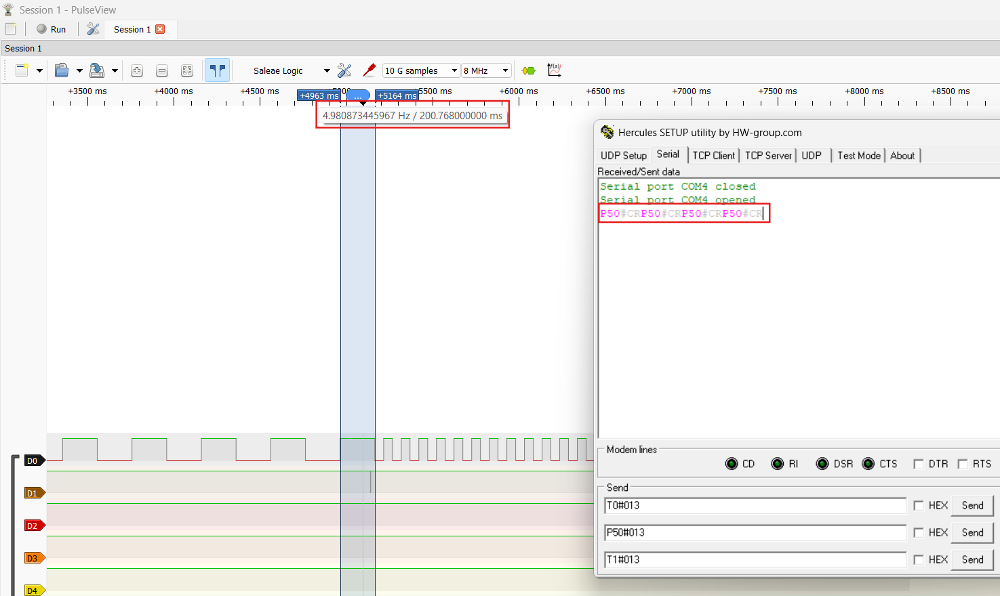
    
    + Sau khi gửi liên tiếp 4 lần `P50\r`, PC13 toggle với chu kỳ mới là 50ms. Gửi liên tiếp 4 lần là vì trigger level của em là 16 bytes, trong khi lệnh trên chỉ có 4 bytes, chưa đủ trigger.
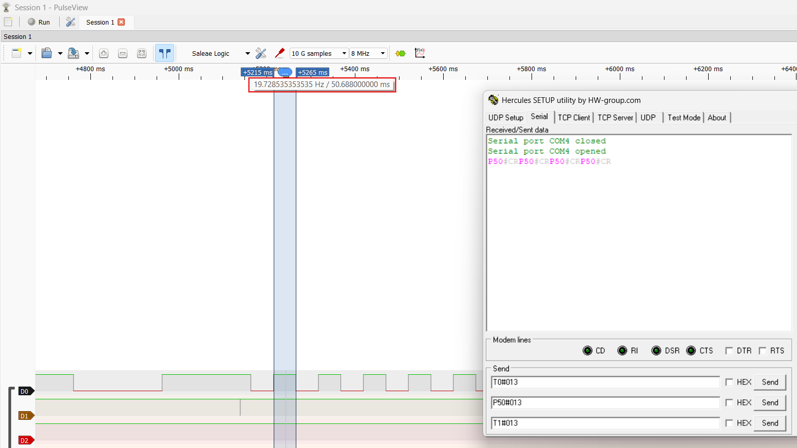

- **Phản ứng với `S`:** Để xem ảnh hưởng của việc đổi priorty của demo_task cao hơn priorty của parser_task. Em có thêm 1 lệnh toggle pin PA7 bên trong parser_task để kiểm tra. Nếu sau trigger, parser_task được khởi chạy liên tục mà không bị task khác (ở đây là demo task) chen vào, ta sẽ thấy xung của PA7 tương đối đều nhau (khoảng cách giữa 2 cạnh chính là workload của parser_task). Ngược lại, nếu xung PA7 (đại diện cho parser_task) không đều thì điều này chứng tỏ rằng parser_task đã bị preempt trong quá trình thực thi. Hoặc nếu task khác không nhường CPU, parser_task sẽ bị starvation luôn thì khi đó ta sẽ không thấy xung PA7.
    + Trước khi gửi `S01\r`, PA7 không toggle vì parser_task đang bị Blocked do yêu cầu Received Stream buffer nhưng buffer đang trống.

    
    + Sau khi gửi liên tiếp 4 lần `S01\r`, PA7 toggle với độ rộng giữa các cạnh tương đối đều nhau. Việc này chứng tỏ parser_task không bị preempt hoặc bị chiếm CPU trong quá trình thực thi, do nó đang có priorty cao nhất (cao hơn demo_task).
    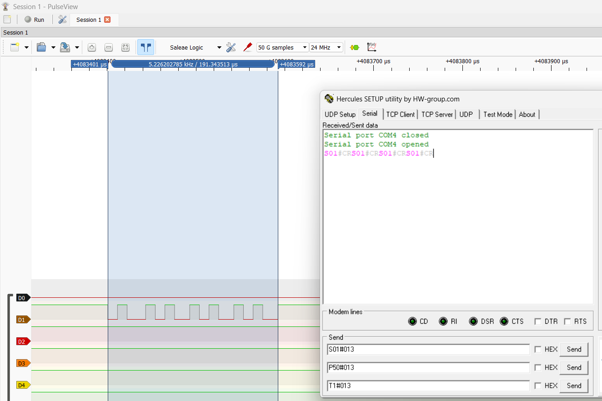
    + Trước khi gửi `S04\r`, PA7 không toggle vì parser_task đang bị Blocked do yêu cầu Received Stream buffer nhưng buffer đang trống.

    + Sau khi gửi liên tiếp 4 lần `S04\r`, PA7 vẫn toggle với độ rộng giữa các cạnh tương đối đều nhau. Việc này chứng tỏ parser_task không bị preempt hoặc bị chiếm CPU trong quá trình thực thi, mặc dù demo_task đã được thay đổi thành priorty cao hơn. Lý do là vì workload của demo_task rất nhỏ (chỉ toggle PC13) rồi call Delay để blocked trong khoảng thời gian từ 1ms trở lên (lớn hơn workload của parser_task). Vì vậy, dường như parser_task được được khởi chạy liền mạch trong suốt quá trình demo_task bị Blocked. Nên ta sẽ không thấy được ảnh hưởng.
    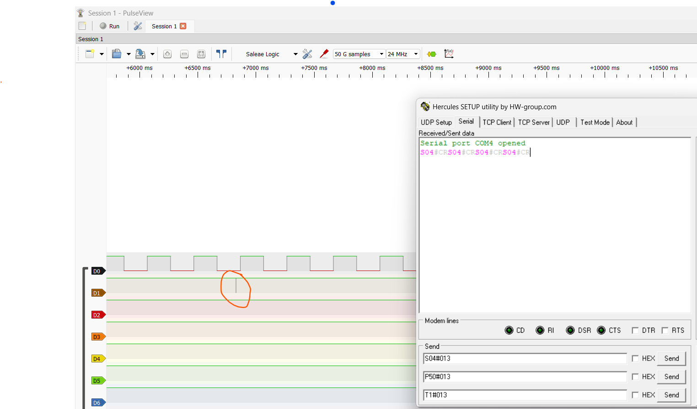
    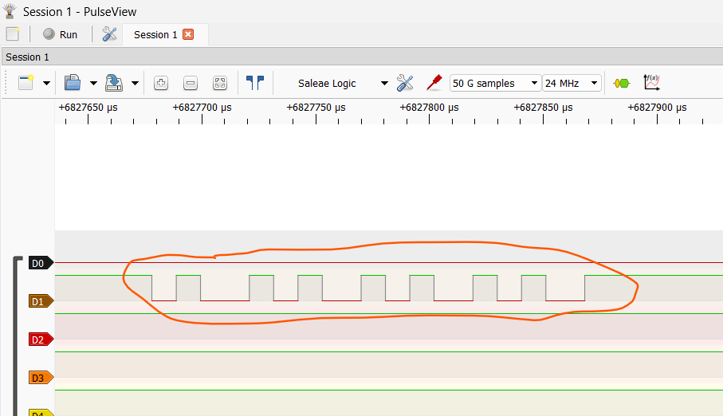
    + Muốn thấy được ảnh hưởng, em thử đổi cơ chế delay từ `vTaskDelay()` sang `HAL_Delay()`. Lúc này, parser_task hoàn toàn bị starvation bởi demo_task do demo_task không nhả CPU. Quan sát ta sẽ thấy là PA7 bị toggle xuống 1 lần (lúc này demo_task vẫn chưa đổi sang priorty mới do hàm apply_command chưa thực thi), sau đó giữ mãi ở mức LOW vì lúc sau apply_command đã thực thi và set priorty của demo_task sang mức cao hơn parser_task hiện tại.
    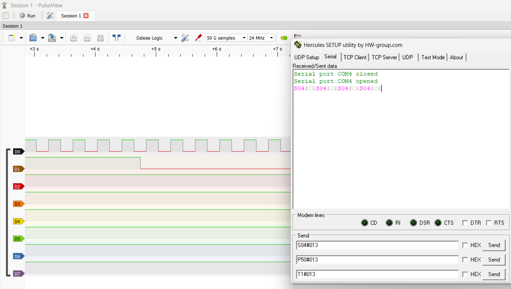

- **Phản ứng với `T`:**
    + Trước khi gửi `T0\r`: PC13 toggle với chu kỳ  mặc định là 200ms.

    + Sau khi gửi `T0\r`: demo_task bị suspend, PC13 không còn toggle. Lưu ý là phải gửi lệnh đó liên tiếp 6 lần (3 * 6 = 18 bytes) thì mới đủ trigger (ngưỡng 16 bytes).
    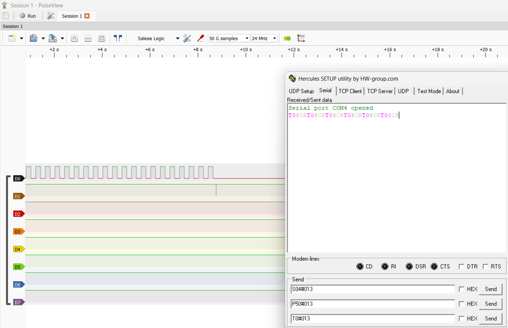

## 3. Test gửi nhanh
| | Số lệnh gửi | Số lệnh nhận đúng | Mất/lỗi |
|---|---|---|---|
| Gõ tay bình thường |8|8|0|
| Gửi liên tục (script) |30|30|0|

Nếu có mất byte: giải thích bằng cơ chế (stream buffer đầy, parser bị trễ,
hay nguyên nhân khác) — không chỉ nói "bị mất".

**Trả lời:**
- Note: 1 lệnh gửi test ở trên dài 4 byte (lệnh `T1\r`/`T0\r`).
- **Cách đo kiểm chứng:** Bên trong ISR của UART, khi `xStreamBufferSendFromISR()` thất bại (trả về 0 byte), tương đương với Stream buffer bị đầy nên không gửi được, em sẽ toggle PA7 1 lần. Kết hợp quan sát trạng thái của PC13. Để quan sát trạng thái theo từng lệnh thì em tạm chỉnh trigger level = 1 byte để mỗi lệnh gửi đi đều sẽ trigger thay vì phải gửi 4 lệnh như mặc định.
    + Em test gửi thông thường bằng cách gửi đi từng lệnh 4 bytes (`T1\r` và `T0\r` xen kẽ nhau). Lệnh `T0\r` sẽ suspend demo_task, nếu stream buffer nhận lệnh này thì ta sẽ quan sát thấy PC13 không toggle nữa. Lệnh `T1\r` sẽ resume demo_task, nếu stream buffer nhận lệnh này thì ta sẽ quan sát thấy PC13 toggle trở lại. Mục đích của việc gửi xen kẽ này là để dễ quan sát sự thay đổi. Dựa trên đếm sự thay đổi đó, ta sẽ xác định được số lệnh nhận đúng/bị mất/lỗi. Ngoài ra, một hệ quả của việc stream buffer không đầy chính là sẽ không thấy PA7 bị toggle sau khi gửi.
    + Em test gửi liên tục bằng cách tạo một script gồm 30 lệnh (chia đều cho 2 lệnh `T1\r` và `T0\r`, mỗi lệnh có 15 lần, xen kẽ nhau, tổng 1 lần gửi script là 120 bytes). Ghi nhận lại trạng thái của PC13 và PA7 để đánh giá xem liệu stream buffer có bị đầy hay không.
- **Kết quả thực tế:** Số lần demo_task thay đổi trạng thái suspend/resume (biểu hiện qua PC13) tương ứng với số lệnh gửi đi. Ngoài ra, PA7 cũng không bị toggle lần nào => Với code hiện tại, ở cả 2 cách gửi (bình thường và liên tục) đều không mất byte.
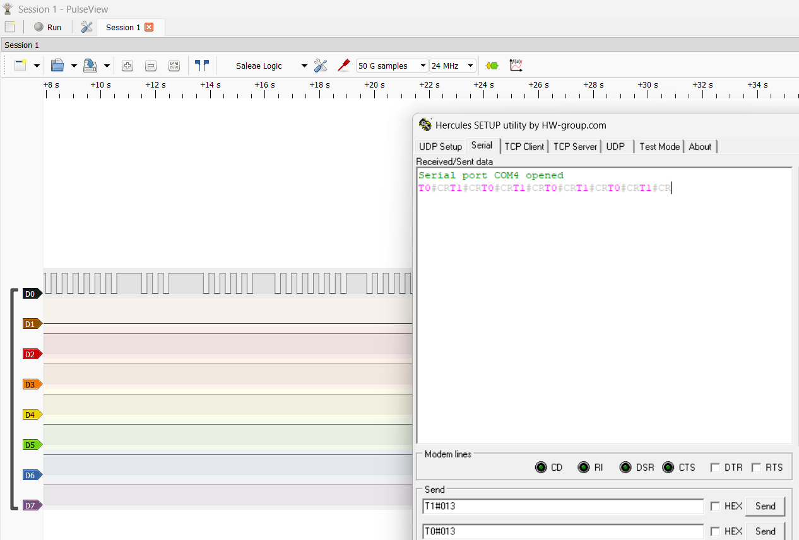
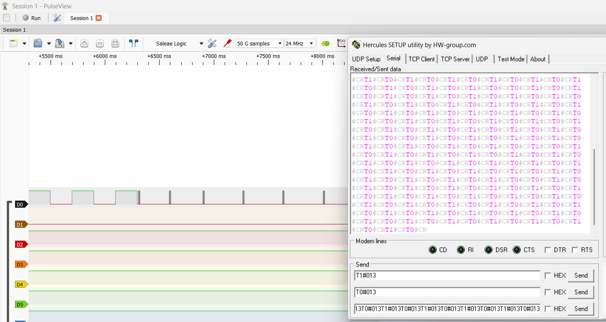
- **Giải thích:** Với baudrate 57600, thời gian gửi 1 byte (8N1) xấp xỉ 173.61 us, lớn hơn thời gian workload của parser_task trong bài này rất nhiều. Vì vậy, dù là gửi script lệnh nhưng thời gian UART gửi đi 1 byte vẫn lớn hơn thời gian xử lý 1 byte của parser task, nên stream buffer không bị đầy. Nếu thử tăng thời gian workload của parser_task lên, ta sẽ thấy có lúc gửi script sẽ khiến buffer bị đầy (PA7 toggle có toggle, xem hình dưới, kênh D1):
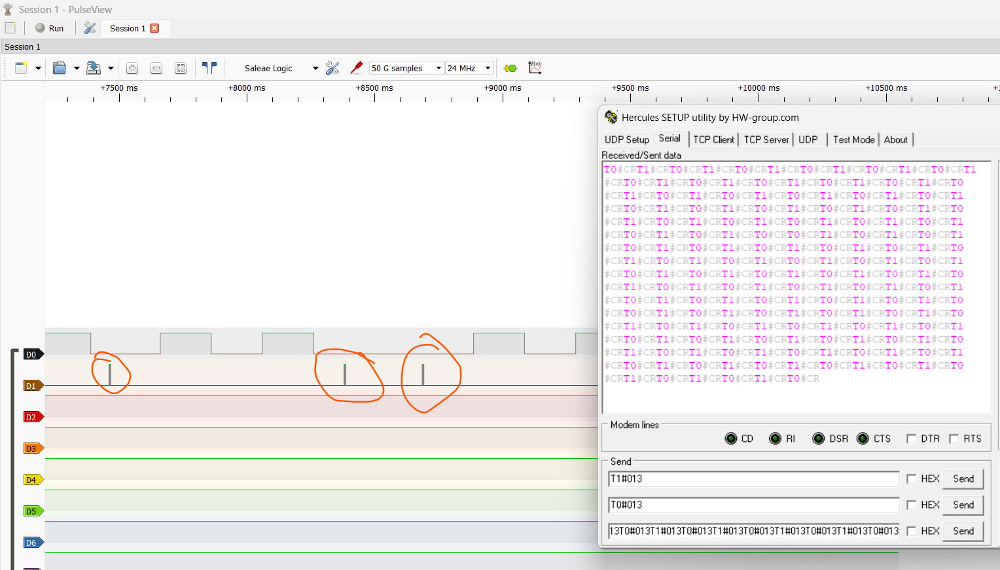


## 4. Vì sao stream buffer, không phải queue
Giải thích bằng lời của bạn.

**Trả lời:** 
- Trong bài này, dữ liệu UART được nhận dưới dạng một chuỗi byte liên tục, không có kích thước message cố định. Vì vậy, Stream Buffer phù hợp hơn Queue.
- Stream Buffer được thiết kế để lưu và truyền một luồng byte liên tục theo thứ tự FIFO, trong đó mỗi lần gửi hoặc nhận có thể có số byte khác nhau. Parser có thể lấy từng byte ra và tự xác định điểm kết thúc của lệnh bằng ký tự \r.
- Ngược lại, Queue phù hợp khi dữ liệu được tổ chức thành các phần tử/message có kích thước xác định. Nếu dùng Queue cho UART byte stream, có thể phải đưa từng byte vào một phần tử queue hoặc tự xây dựng thêm cơ chế ghép các byte thành message. 
- Do đó, với mô hình: UART RX -> ISR -> Stream Buffer -> Parser Task, Stream Buffer phù hợp hơn.

## 5. Lệch so với dự đoán
Mỗi mục lệch + nguyên nhân.

**Trả lời:** 
Dự đoán về khả năng mất byte do gửi script lệnh:
- Dự đoán đúng xu hướng rằng nếu baudare tăng cao trong khi tốc độ xử lý của parser_task không đáp ứng kịp thì sẽ dẫn đến mất byte. Tuy nhiên về mặt định lượng, khó có thể dự đoán chính xác mất bao nhiêu byte vì không chỉ dựa vào baudrate, hay độ chênh lệch kích thước giữa script lệnh với stream buffer, mà còn tùy thuộc vào thời gian xử lý thực tế của parser_task, thời điểm các byte được gửi đến,...
- Để biết chính xác mất bao nhiêu byte lệnh trong 1 script gửi đi thì ta nên thực nghiệm, có thể đặt tăng biến count lên thêm 1 mỗi khi StreamBufferSend không thành công. Sau đó debug để xem giá trị hoặc log ra UART.

## 6. Câu hỏi đánh đổi
Với `RX_BAUD` của bạn, nếu tăng gấp đôi `STREAM_BUFFER_BYTES`, tốc độ gửi tối đa không mất byte tăng thêm bao nhiêu (đo thật, không suy luận)?

**Trả lời:**
- Cấu hình câu 6: `RX_BAUD = 57600 baud`, `STREAM_BUFFER_BYTES = 192 bytes`.
- Ở cấu hình trước đó (stream buffer size chỉ bằng 1 nửa, 96 bytes), theo như phân tích và đo thực tế ở các câu trước chỉ ra rằng không xảy ra mất byte (do stream buffer bị đầy) vì thời gian xử lý của parser_task nhỏ hơn nhiều so với thời gian UART gửi 1 byte với baudrate này. Khi thử tăng baudate lên mức tối đa của Hercules (115200 baud) thì cũng không thấy xảy ra hiện tượng stream buffer bị đầy => Nếu tăng không gian lưu trữ của stream buffer lên gấp đôi (192 bytes) cũng sẽ không bị đầy nếu baudrate là 115200 baud.
- **Kiểm chứng thực tế với cấu hình câu 6:** Gửi script nhiều lần vẫn không mất byte (PA7 không toggle, quan sát kênh D1)
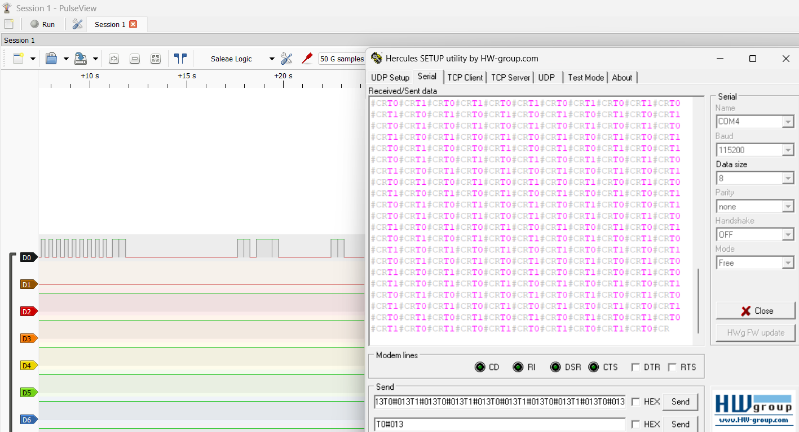
- **Kết luận:** Nếu tiếp tục tăng baudrate lên cao hơn 115200, khả năng sẽ có bị mất byte. Tuy nhiên với giới hạn về baurate của phần mềm Hercules hiện tại, em chưa thể kiểm chứng chính xác được tốc độ đó sẽ chính xác là bao nhiêu.