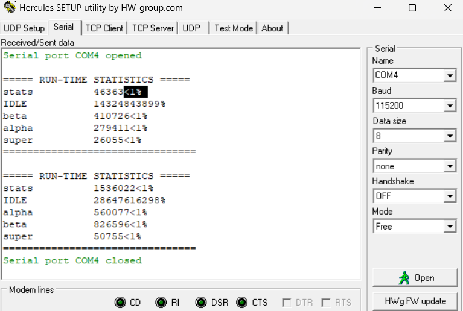
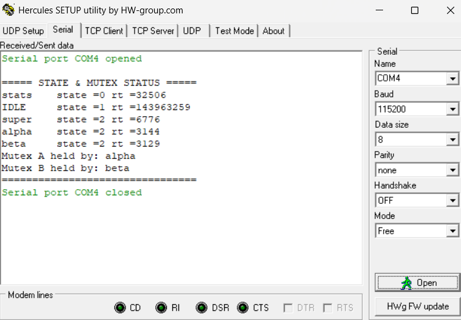
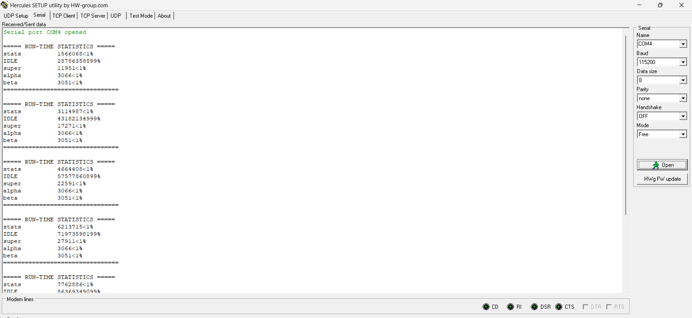
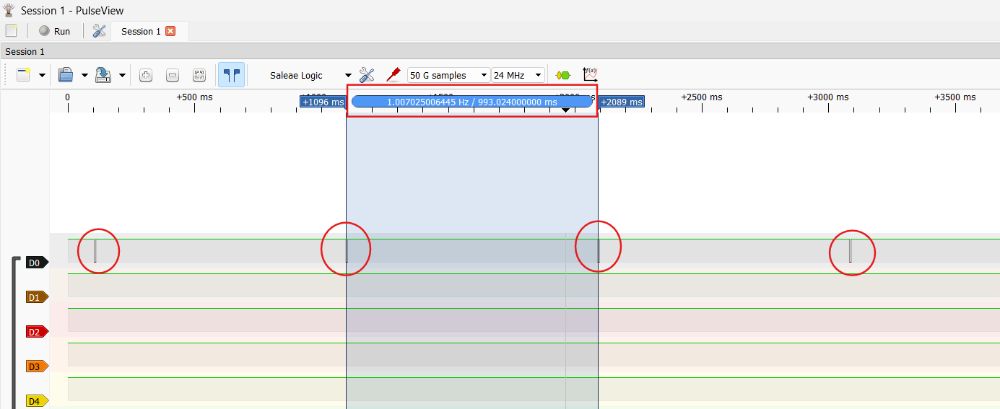
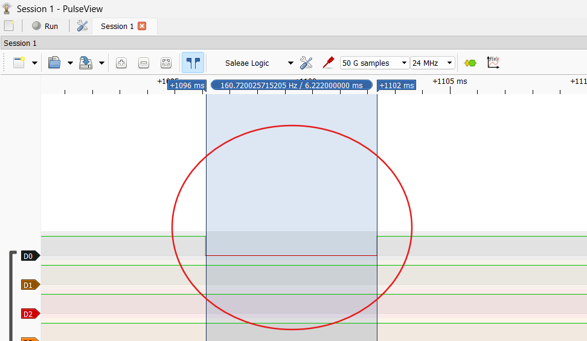
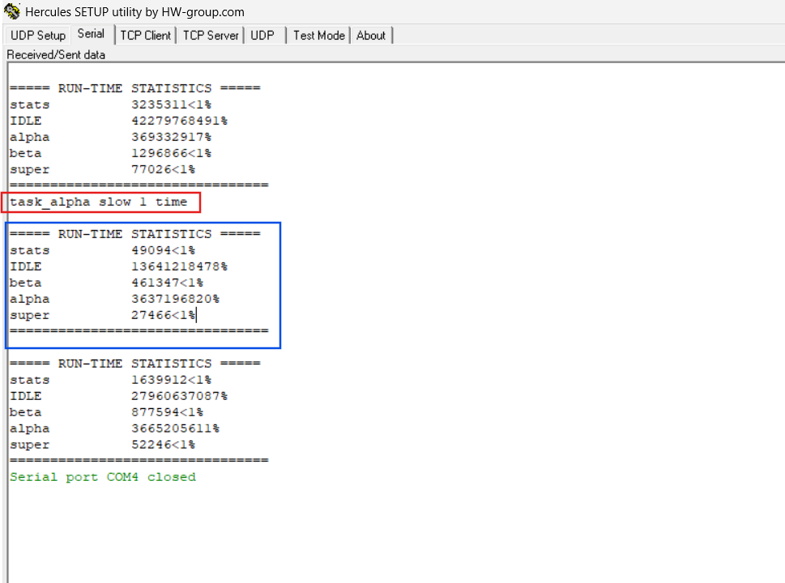

# Report — Week 3 / Ex4

`student_id`: 2413505    Commit của PREDICTION.md: `"feat: submit Prediction file for ex4 w3"`

## 1. Bảng CPU %
| Task | CPU % (lần đo 1) | CPU % (lần đo 2) |
|---|---|---|
|IDLE|99%|98%|
|alpha|<1%|<1%|
|beta|<1%|<1%|
|supervisor|<1%|<1%|
|stats|<1%|<1%|

- **Đo lần 1 & 2:**


Giải thích Idle task chiếm bao nhiêu % và vì sao.
- Idle task chiếm khoảng 98 - 99%. Idle là task ưu tiên 0, chỉ chạy khi mọi task khác đều bị blocked. Vì alpha, beta, super và stats gần như luôn blocked nên Idle chiếm phần lớn CPU.

## 2. Bằng chứng tìm deadlock
Log/ảnh `uxTaskGetSystemState` **trước khi sửa**: trạng thái từng task, chỉ
rõ `task_alpha`/`task_beta` đang `eBlocked` và đang chờ mutex nào. Giải thích chính xác thứ tự lấy mutex nào gây ra deadlock (AB-BA).

- **Ảnh log UART qua Hercules:**

    + Note: 0 - eRunning, 1 - eReady, 2 - eBlocked

- **Giải thích thứ tự lấy mutex gây ra deadlock:**
    + task_alpha lấy mutex_a rồi gọi Delay để blocked 5ms.
    + Sau đó, task_beta thực thi, lấy mutex_b rồi tương tự cũng gọi Delay để blocked 5ms. Tổng thời gian để scheduler chuyển context từ task_alpha đến task_beta và thực thi lệnh lấy mutex_b + call Delay rất nhỏ, nhỏ hơn nhiều so với 1 Tick (tương ứng 1ms theo cấu hình) => task_alpha và task_beta coi như đồng thời cùng bị Delay 5ms tại cùng thòi điểm tick, cả 2 task cùng đua.
    + Sau 5ms, cả 2 task đều Ready. task_alpha thực thi trước, yêu cầu lấy mutex_b nhưng không được (do task_beta đang giữ) nên bị blocked. task_beta yêu cầu lấy mutex_a nhưng do task_alpha đang giữ và chưa nhả nên cũng bị blocked => cả 2 task rơi vào deadlock.
    
    => Thứ tự lấy AB-BA sẽ gây ra deadlock.


## 3. Sửa lỗi
Mô tả thay đổi bạn làm để hết deadlock (thứ tự lấy mutex thống nhất). Xác
nhận chạy ổn định sau khi sửa (thời gian chạy thử).

**Trả lời:**
- **Cách làm:** Thống nhất thứ tự lấy mutex. Cả hai task alpha và beta đều lấy mutex_a trước, sau đó mới lấy mutex_b.
```
task_alpha: mutex_a -> mutex_b
task_beta: mutex_a  -> mutex_b
```

+ Khi task_alpha đang giữ mutex_a, task_beta sẽ phải chờ mutex_a. Sau khi task_alpha lấy được mutex_b, thực hiện công việc và nhả cả mutex_b và mutex_a, task_beta mới có thể tiếp tục. Như vậy không còn tình trạng một task giữ mutex_a và chờ mutex_b, trong khi task còn lại giữ mutex_b và chờ mutex_a. Do đó không có vòng chờ tạo ra deadlock.

- **Kiểm chứng:** Sau khi sửa, chạy hệ thống trong thời gian 5s và theo dõi log UART. Hệ thống vẫn tiếp tục hoạt động, các task vẫn thực hiện các chu kỳ bình thường và không bị treo. IWDG không thực hiện reset hệ thống trong quá trình chạy thử => thấy UART có log ra nội dung.


## 4. Watchdog
Phép tính reload IWDG. Log/video board tự reset khi deadlock được tái tạo lại
có chủ đích, kèm thời gian từ lúc treo đến lúc reset — so với
`IWDG_TIMEOUT_MS`.

**Trả lời:**

**Phép tính reload:**
+ Công thức tính thời gian của IWDG: 
```
Timeout = (Reload + 1) * Prescaler / f_LSI
```
+ Theo công thức trên, ta sẽ thấy có 2 thông số tùy chỉnh là Reload value và Prescaler. Cố định 1 thống số, giả sử ta chọn Prescaler = 16, với `IWDG_TIMEOUT_MS = 1000 ms`, khi đó:
```
Reload = (Timeout * f_LSI / Prescaler) - 1
       = (1 * 40K / 16) - 1 = 2499
```
+ **Vậy reload value của em là 2499.**

**Phương pháp đo kiểm thực tế:** Xem thời gian treo tính từ lúc bị deadlock (tức ngay sau khi task_beta bị Blocked bởi lấy mutex_a không thành công, ngay trước đó task_alpha đã bị Blocked bởi lấy mutex_b không thànhh công) đến khi hệ thống reset => Em đo bằng cách set pin GPIO. Ngay sau khi task_beta vừa được Running sau thời gian delay 5ms và trước khi nó gọi API `xSemaphoreTake(s_mutex_a, portMAX_DELAY)`, em sẽ set pin PA7 lên HIGH. **Khoảng thời gian PA7 giữ ở mức HIGH chính là khoảng thời gian tính từ lúc bị deadlock đến khi bị reset** (sau reset thì pin GPIO mặc định mức LOW nên xung bị kéo xuống).
- **Đo kiểm chứng:**
    + Các vùng khoanh tròn trong hình là những lúc hệ thống bị reset (PA7 LOW do reset rồi lại HIGH do task_beta chạy đến lệnh lấy mutex_a)
    
    
    + Khi zoom hình lên, ta sẽ thấy khoảng cách giữa 2 cạnh xấp xỉ `6.22ms`. Giải thích cho điều này: Vì em đặt lệnh set PA7 ngay sau `vTaskDelay(5ms)`, nên sau khi reset thì hệ thống phải trả qua giai đoạn trước khi bị deadlock (như đã phân tích ở các câu trước: task_alpha lấy mutex_a rồi blocked 5ms, task_beta...), tính thêm các chi phí chuyển đổi ngữ cảnh, supervisor_task thực thi...=> tổng `6.22ms` là hợp lý.

## 5. Lệch so với dự đoán
Mỗi mục lệch + nguyên nhân.
- **Thời điểm xảy ra deadlock:** Kết quả thực tế phù hợp với dự đoán. Deadlock xảy ra sau khi task_alpha và task_beta lần lượt giữ hai mutex khác nhau và chờ mutex còn lại.
- **Trạng thái của hai task:** Kết quả uxTaskGetSystemState() phù hợp với dự đoán: task_alpha và task_beta đều chuyển sang trạng thái eBlocked, tạo thành vòng chờ giữa mutex_a và mutex_b.
- **Thời gian trước khi deadlock:** Kết quả đo được khoảng 6.22 ms, lớn hơn thời gian 5 ms dự đoán. Nguyên nhân là 5 ms là thời gian vTaskDelay() danh định, trong khi thời gian thực tế còn bao gồm thời điểm task được scheduler lập lịch lại và các overhead thực thi khác.
- **Watchdog reset:** Hệ thống thực tế tự reset sau khi deadlock được tái tạo, phù hợp với dự đoán rằng supervisor không nhận đủ các bit check-in nên không tiếp tục refresh IWDG. Thời gian reset thực tế có thể lệch so với IWDG_TIMEOUT_MS = 1000 ms do f_LSI thực tế không đúng chính xác giá trị danh định 40 kHz và sai số đo.


## 6. Câu hỏi đánh đổi
Với `SUPERVISOR_BITS` và chu kỳ check-in của bạn, nếu một task thật sự chạy
chậm (không deadlock, chỉ chậm) trong đúng 1 chu kỳ, supervisor có false-trip
(reset oan) không? Trả lời bằng số đo thời gian thực tế của chu kỳ check-in.

**Trả lời:** 
- **Cách thực nghiệm:**  Em mô phỏng tình huống một task chạy chậm duy nhất trong một chu kỳ bằng cách tạo biến one_slow = 1. Bên trong task_alpha, nếu one_slow == 1, em đặt lại one_slow = 0 để đảm bảo việc chạy chậm chỉ xảy ra một lần, sau đó thực hiện thêm workload khoảng 500 ms bằng HAL_Delay(500) và log ra UART dòng `task_alpha slow 1 time` để đánh dấu chu kỳ bị làm chậm.
- **Kết quả:** Trong chu kỳ mà task_alpha chạy chậm, hệ thống đã bị false-trip. Bằng chứng là ta chỉ thấy log text `task_alpha slow 1 time` mà không có log bảng CPU trong chu kỳ đó.

- **Note:** Ô màu đỏ là log của chu kỳ mà có task_alpha chạy chậm, ô màu xanh là log của chu kỳ sau đó (không có task chạy chậm).
- **Kết luận:** Với cấu hình hiện tại, supervisor có thể false-trip khi một task chạy chậm đến mức thời gian không check-in xấp xỉ hoặc vượt quá cửa sổ giám sát 500 ms. Điều này cho thấy việc chọn thời gian supervisor window phải tạo đủ khoảng đệm so với chu kỳ check-in thực tế để tránh reset oan khi hệ thống chỉ bị chậm tạm thời.