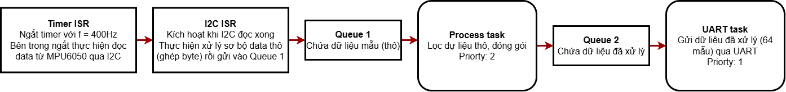

# Report — Week 4 / Ex1 (Design doc)

`student_id`: 2413505    Commit của PREDICTION.md: `"feat: submit Prediction file for ex1 w4"`

> File này ĐÓNG VAI TRÒ design doc 2–3 trang nộp cho mentor duyệt trước khi
> viết code. Điền đủ số liệu — không mô tả chung chung.

## 1. Task diagram
Mô tả (sơ đồ ASCII hoặc ảnh chèn vào) luồng: ISR lấy mẫu MPU6050 → hàng đợi
→ task xử lý → task ghi UART. Ghi rõ priority từng task.

**Trả lời:**

**Note:** Hàm đọc I2C mà em tính sử dụng là `HAL_I2C_Mem_Read_IT()`. Sau khi I2C đọc xong thì sẽ kích hoạt ngắt, không gây polling: ISR timer chỉ khởi động việc đọc rồi thoát ngay, việc truyền I2C chạy nền nên CPU không bị giữ trong suốt thời gian truyền (ước tính lý thuyết khoảng 0.39 ms cho 14 byte ở 400 kHz). Khi truyền xong, callback `HAL_I2C_MemRxCpltCallback` ghép byte, gắn timestamp rồi gửi mẫu vào Queue 1 bằng `xQueueSendFromISR`. Vì vậy thời gian truyền I2C được xem là chạy nền, không tính vào thời gian xử lý mẫu của task.

## 2. Timing budget
| Đại lượng | Công thức / nguồn số liệu | Giá trị |
|---|---|---|
| Chu kỳ lấy mẫu | 1 / `SAMPLE_RATE_HZ` |2.5 ms|
| Latency ISR→task (đo thật, week3/ex1) |đo thật, trong report week3/ex1|12.99 us|
| Thời gian xử lý 1 mẫu (ước lượng) |giải thuật xử lý mẫu dự kiến sử dụng là bộ lọc trung bình trượt, tương đối đơn giản nên dự kiến workload sẽ không nhiều. Cộng thêm thời gian `xQueueReceive` từ Queue 1 và `xQueueSend` ra Queue 2 => **ướC tính khoảng 1000 chu kỳ CPU** => 1000 / 72MHz|13.89 us|
| Tổng so với `ISR_TO_PROC_DEADLINE_US` |12.99 + 13.89 = 26.88 (us) << `ISR_TO_PROC_DEADLINE_US = 300 us`|Đạt|

## 3. RAM budget
| Thành phần | Kích thước | Ghi chú |
|---|---|---|
| Queue 1 (độ dài × cỡ phần tử) |16 bytes x 16 phần tử = 256 bytes; `Queue_t` 76 bytes; overhead 12 bytes|chứa data thô (đã ghép)|
| Queue 2 (độ dài × cỡ phần tử) |16 bytes x 64 phần tử = 1024 bytes; `Queue_t` 76 bytes; overhead 12 bytes|chứa data sau xử lý|
| Stack task lấy mẫu | |không dùng trong cấu hình này|
| Stack task xử lý |128 words = 512 bytes (stack riêng của task); TCB 76 byte; overhead 20 byte => 608 bytes| |
| Stack task ghi UART |128 words = 512 bytes (stack riêng của task); TCB 76 byte; overhead 20 byte => 608 bytes| |
| Stack IDLE task |128 words = 512 bytes (stack riêng của task); TCB 76 byte; overhead 20 byte => 608 bytes|task mặc định được RTOS tạo, lựa chọn cấp phát động từ heap|
| **Tổng** |256 + 1024 + (76 + 12) * 2 + 608 * 3 = 3280 bytes| So với `MAX_HEAP_BYTES = 10240 bytes` thì bé hơn, dư 6960 bytes => Đạt|

## 4. Lựa chọn API đồng bộ
Queue / event group / stream buffer — vì sao chọn cái này cho pipeline này.

**Trả lời:** Em chọn **queue** (`xQueueSendFromISR`, `xQueueReceive`, `xQueueSend`) cho cả Queue 1 và Queue 2.
- **Dữ liệu là các mẫu có cấu trúc cố định.** Mỗi mẫu là một nhóm 16 byte, queue truyền theo giá trị từng phần tử nguyên vẹn và giữ đúng thứ tự FIFO. Task nhận không phải tự tách ranh giới mẫu.
- **Cần đệm khi consumer chậm.** Process hoặc UART có lúc bị chậm, dẫn đến không kịp xử lý khi data lấy mẫu đến => Queue có độ sâu, có thể chứa tạm các mẫu đó.
- **Có sẵn bản `FromISR` và chặn task đúng cách.** Callback I2C gửi bằng `xQueueSendFromISR` không chờ; task nhận dùng `xQueueReceive` với `portMAX_DELAY` nên chuyển sang Blocked khi queue rỗng, không tốn CPU.
- **Quan sát được độ đầy.** Có thể dùng `uxQueueMessagesWaiting` để đo mức dồn của queue.

Vì sao không chọn các cách khác:
- **Event group** chỉ mang các bit cờ, không mang dữ liệu và không đệm được, nên không chuyển được mẫu cảm biến.
- **Task notification** chỉ mang một giá trị 32 bit và không xếp hàng được nhiều mẫu, nên không đủ cho struct 16 byte.
- **Stream buffer** là dòng byte, chỉ cho phép một bên ghi và một bên đọc, và không giữ ranh giới giữa các mẫu.

## 5. Xử lý khi hàng đợi đầy
Drop mẫu mới hay mẫu cũ? Có đếm số mẫu bị rớt để báo cáo ở ex3 không?

**Trả lời:**
- Nếu gửi vào Queue từ ISR thông qua API `xQueueSendFromISR` không chờ, mẫu mới sẽ bị drop ngay nếu Queue đầy vào thời điểm đó, trong khi các mẫu cũ ở trong Queue trước đó vẫn giữ nguyên.
- Trong giải thuật mà em dự tính code sẽ có logic đếm số mẫu bị rớt. Em sẽ kiểm tra giá trị trả về của `xQueueSendFromISR`, nnếu khác `pdPASS` thì tăng biến đếm lên.

## 6. Mentor duyệt
Chữ ký / ghi chú của mentor sau buổi duyệt thiết kế: ______
